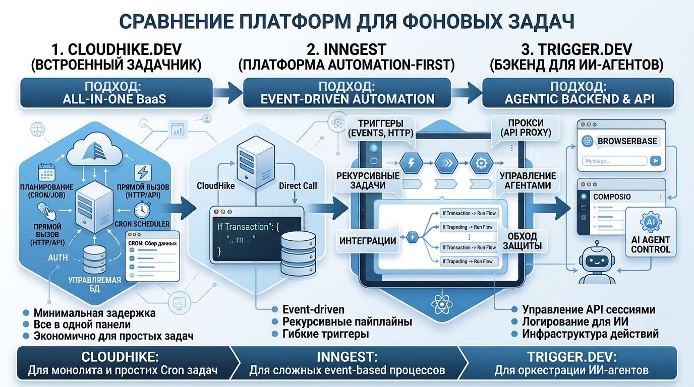

# Архитектурный анализ: CloudHike Jobs vs. Inngest vs. Trigger.dev

В современных приложениях с ИИ-агентами выполнение задач по расписанию (Cron) и фоновая обработка требуют надежного оркестратора. Ниже приведен детальный разбор принципов работы **CloudHike Jobs** и их сравнение с платформами **Inngest** и **Trigger.dev**.

---



## 1. CloudHike Jobs (Подход в архитектуре приложения)

В рассматриваемой архитектуре **CloudHike Jobs** выполняет роль классического managed Job Scheduler (аналог встроенного Cron/Worker сервиса в BaaS по типу Supabase Cron / Upstash QStash).

### Основные принципы работы:

1. **HTTP Target Endpoints (Webhooks):**
   - CloudHike Jobs не исполняет Node.js код у себя внутри. Вместо этого он по расписанию (или по событию) отправляет авторизованный `POST`-запрос на серверный Route Handler приложения (например, `https://myapp.com/api/jobs/update-widgets`).
2. **Гарантия выполнения и Retry Policy:**
   - Автоматические повторные попытки (exponential backoff) при неудачных ответах сервера (HTTP 5xx).
3. **Безопасность (Secret Signature Verification):**
   - Каждая задача подписывается секретным заголовком (`X-CloudHike-Signature`), чтобы Next.js бэкенд мог убедиться, что запрос пришел именно от планировщика CloudHike, а не от злоумышленника.
4. **Контекст и Payload:**
   - В тело запроса передается JSON-конфиг (например, `agentId`, `dashboardId`, `widgetId`), благодаря чему одна задача может обслужить конкретный виджет.

---

## 2. Сравнительный анализ: CloudHike Jobs, Inngest и Trigger.dev

| Критерий / Особенность               | CloudHike Jobs (BaaS Scheduled Jobs)                                                | Inngest (Event-Driven Flow Engine)                                                                   | Trigger.dev v3 (Serverless Background Jobs)                                                        |
| :----------------------------------- | :---------------------------------------------------------------------------------- | :--------------------------------------------------------------------------------------------------- | :------------------------------------------------------------------------------------------------- |
| **Главная концепция**                | Простой планировщик (Cron / Scheduled HTTP Webhooks).                               | **Event-Driven & Step Functions:** цепочки функций, реагирующие на события с управляемым состоянием. | **Long-running Tasks:** выполнение тяжелых процессов (до нескольких часов) в изоляции.             |
| **Где исполняется код?**             | На вашем Next.js сервере (Vercel / Docker / Node.js).                               | На вашем Next.js сервере через шаги (`step.run()`).                                                  | В изолированной Serverless-инфраструктуре **Trigger.dev** (вынесен за пределы Next.js).            |
| **Лимиты времени (Timeout)**         | Ограничен таймаутом вашего бэкенда (например, 10-60 секунд на Vercel).              | Ограничен таймаутом одного шага, но вся цепочка шагов может длиться дни/недели.                      | **Без жестких лимитов** (может выполняться 1-2+ часа для сложных пайплайнов ИИ).                   |
| **Поддержка шагов (Step Functions)** | Нет. Функция выполняется единым запросом от начала до конца.                        | **Да (Ключевая фича):** `step.run()`, `step.sleep()`, `step.waitForEvent()`.                         | **Да:** разделение кода на `tasks.trigger()` и асинхронное отслеживание статуса.                   |
| **Оркестрация ИИ-агентов**           | Подходит для простых регулярных задач (раз в час выкачать почту и обновить виджет). | Идеален для многошаговых ИИ-цепочек (сначала парсим, потом ждем ответа, потом отправляем email).     | Идеален для тяжелых ИИ-задач (генерация видео, обучение моделей, вызовы Browserbase на 10+ минут). |
| **Durable Execution (Снапшоты)**     | Нет. При падении бэкенда задача выполняется заново целиком.                         | **Да.** Если упал шаг №3, Inngest возобновит выполнение строго с шага №3 без повтора шагов №1 и №2.  | **Да.** Полный контроллинг состояния выполнения, логов и ошибок каждого шага.                      |

---

## 3. В чем ключевые различия подходов?

### A. CloudHike Jobs (Модель "Cron Webhook")

- **Плюсы:** Максимальная простота. Не требует дополнительных SDK. Настраивается в пару кликов или через API.
- **Минусы:** Не подходит для длительных задач. Если вашей сессии Browserbase требуется 3 минуты для работы, Vercel Serverless Function обрубит соединение по таймауту (15-60 секунд).

### B. Inngest (Модель "Step-Based Orchestration")

- **Плюсы:** Позволяет разбивать тяжелую задачу на мелкие «шаги» (Steps). Если один из вызовов LLM или Composio упал, Inngest не перевыполняет прошлые действия, а перезапускает только упавший шаг.
- **Как выглядит код:**
  ```typescript
  export const agentJob = inngest.createFunction(
    { id: 'daily-agent-task' },
    { cron: '0 8 * * *' },
    async ({ step }) => {
      const emails = await step.run('fetch-gmail', () => fetchGmail())
      const summary = await step.run('llm-summarize', () => summarize(emails))
      await step.run('update-widget', () => updateWidget(summary))
    },
  )
  ```

### C. Trigger.dev (Модель "Off-Main-Server Long Running Jobs")

- **Плюсы:** Решает главный недостаток Serverless (Vercel) — лимит по времени и памяти. Код выносится из Next.js на специальный воркер Trigger.dev, где может работать хоть полчаса, используя Playwright, Puppeteer или тяжелые библиотеки обработок медиа.
- **Как выглядит код:**
  ```typescript
  export const browserTask = task({
    id: 'run-browserbase-deep-scrape',
    run: async (payload: { url: string }) => {
      // Может выполняться хоть 30 минут без риска таймаута Next.js!
      const data = await runLongBrowserbaseSession(payload.url)
      return data
    },
  })
  ```

---

## 4. Резюме: Что выбрать для AI Agentic Dashboard?

1. **Используйте CloudHike Jobs, если:**
   - Вам нужно простое расписание (каждое утро в 8:00 дернуть API Route, который обновит погоду или простой виджет).
   - Все операции внутри задачи выполняются быстро (до 10-15 секунд).

2. **Используйте Inngest, если:**
   - У вас сложный бизнес-процесс из нескольких последовательных этапов (наприм.: спарсить → обработать через LLM → отправить в Slack → дождаться ответа человека → обновить БД).
   - Нужна защита от повторных затрат на LLM-токены при сбоях (Durable Execution).

3. **Используйте Trigger.dev, если:**
   - Агент выполняет глубокую веб-автоматизацию через Browserbase, которая занимает от 2 до 15+ минут.
   - Нужна изолированная среда, не зависящая от ограничения серверов Next.js/Vercel.
