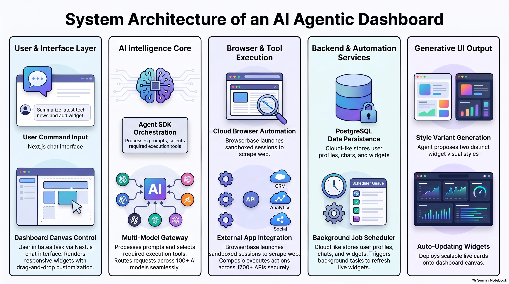
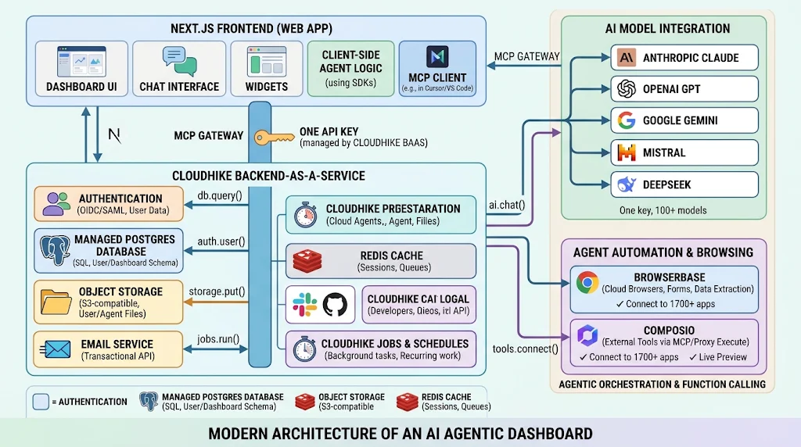
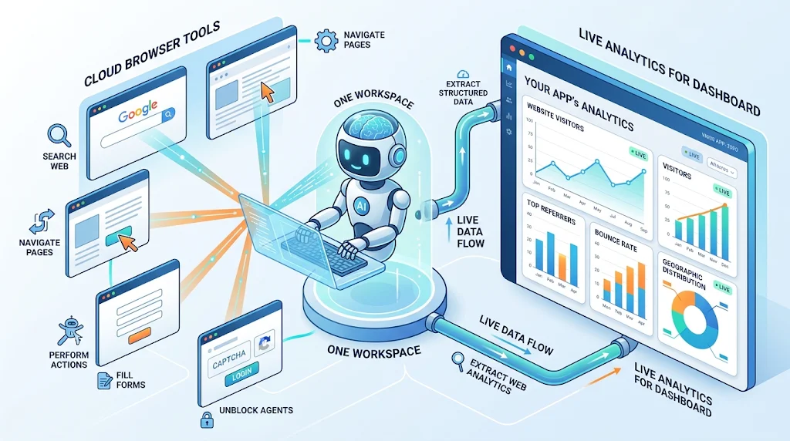
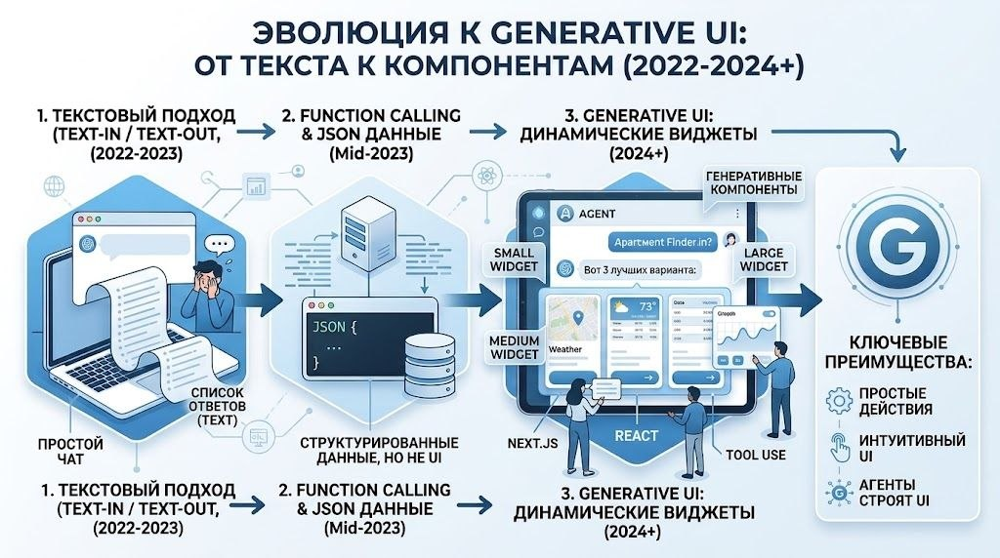
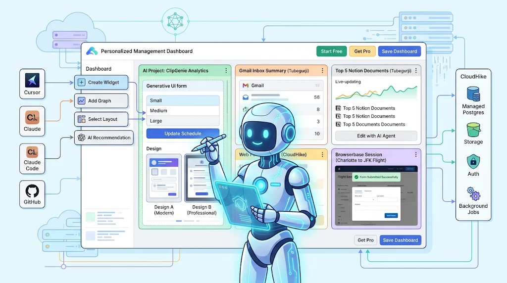
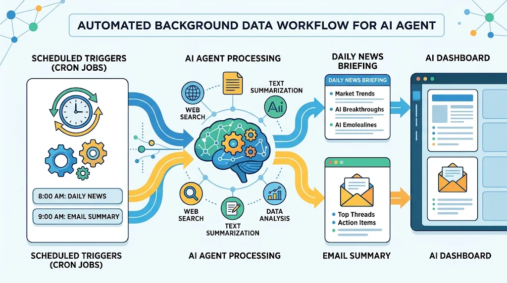
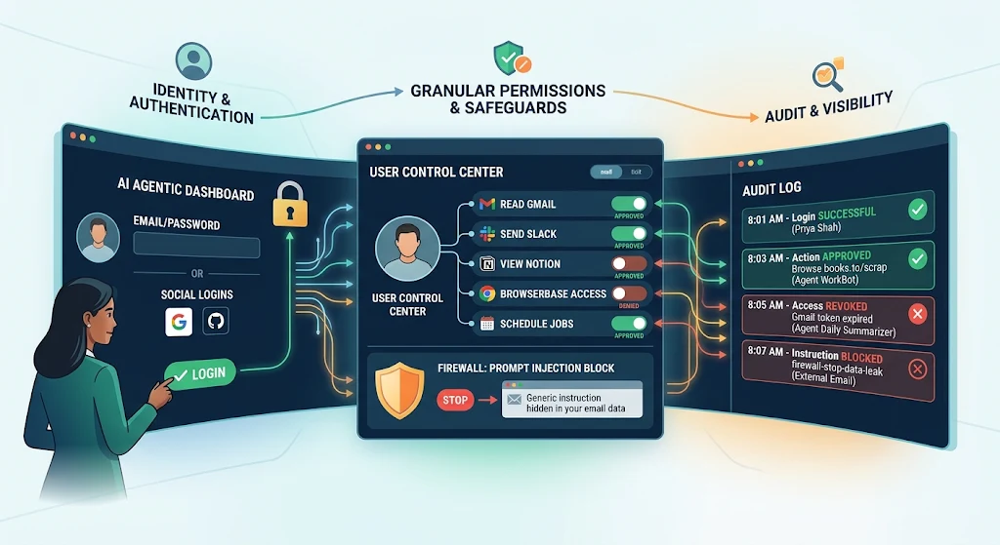

# Технический отчет: Создание AI Agentic Dashboard (Next.js + CloudCode)

I’ve been diving deep into full-stack AI development recently, working with and testing a comprehensive architecture for an AI Agentic Dashboard built on Next.js.

Building autonomous agents that go beyond basic chat interfaces requires a well-structured backend ecosystem. Here’s how the core layers connect in this setup:

🔹 Frontend: Next.js App Router providing streaming chat, generative UI widgets, and interactive agent interfaces.

🔹 BaaS / Infrastructure: CloudHike handling managed Postgres, Auth, S3 storage, Redis caching, and automated cron jobs.

🔹 AI Engine & MCP: Connecting multiple LLMs (Claude, GPT, Gemini, DeepSeek) through an MCP gateway with unified API access.

🔹 Agentic Execution: Leveraging Browserbase for cloud web automation and Composio to interface agents with 1700+ external tools (Slack, Gmail, GitHub).



Hands-on experience with this stack really highlights how critical proper orchestration, token management, and background task scheduling are when working with autonomous agents.

---

## 1. Цель проекта

Основная цель проекта — разработка **автономной панели управления на базе ИИ (AI Agentic Dashboard)**. Данная платформа позволяет пользователям создавать индивидуальных AI-агентов, способных:

- **Автоматизировать повседневные и регулярные задачи:** сборы ежедневных сводок новостей, мониторинг веб-метрик, суммаризация входящей почты Gmail.
- **Взаимодействовать со сторонними приложениями:** интеграция с внешними сервисами (Gmail, Slack, Notion, GitHub, Google Drive) через OAuth и MCP/Composio.
- **Использовать удаленный облачный браузер:** интеграция с Browserbase для динамического веб-скрейпинга, заполнения форм и сбора данных с веб-сайтов без прямого API.
- **Визуализировать аналитику:** автоматическое преобразование полученных данных в виджеты (с поддержкой разных размеров: Small, Medium, Large) и генеративный UI.
- **Планировать фоновые задачи (Cron Jobs):** фоновое обновление виджетов и выполнение расписаний с помощью CloudHike Job Scheduler.

---

## 2. Используемые сервисы, фреймворки и библиотеки

| Технология / Сервис          | Тип / Роль                              | Почему выбран                                                                                                                                                  |
| :--------------------------- | :-------------------------------------- | :------------------------------------------------------------------------------------------------------------------------------------------------------------- |
| **Next.js (App Router)**     | Full-stack фреймворк                    | Оптимален для создания высокопроизводительных приложений с серверными компонентами, API Routes и Server Actions.                                               |
| **Cloud Code / Claude Code** | AI Developer Assistant                  | Используется для автогенерации кода по системным промптам прямо в рабочей среде разработки.                                                                    |
| **CloudHike.dev**            | Backend-as-a-Service (BaaS)             | Экономичная альтернатива Supabase/Convex. Предоставляет управляемую PostgreSQL БД, встроенную авторизацию (Auth), S3-хранилище, Redis и фоновые задачи (Jobs). |
| **Drizzle ORM**              | ORM для Node.js/TypeScript              | Легковесная и строгая по типам ORM для работы с SQL-схемами (User, Agent, Dashboard, Widget, Job) и автоматических миграций.                                   |
| **Browserbase**              | Облачный браузер (Browser-as-a-Service) | Предоставляет AI-агентам удаленные сессии Chromium для сложной веб-навигации, обхода капчи и извлечения данных с сайтов.                                       |
| **Composio**                 | MCP Integration Platform                | Предоставляет готовые интеграции по протоколу MCP к 1700+ сервисам (Slack, Gmail, GitHub, Notion) с защищенным управлением OAuth-токенами.                     |
| **OpenAI API / LLM Models**  | Интеллектуальное ядро (LLM)             | Отвечает за генерацию ответов, вызов функций (Tool Use / Function Calling) и принятие решений агентом.                                                         |
| **Tailwind CSS & shadcn/ui** | Интерфейс и компоненты                  | Обеспечивают современный UI/UX в стиле Dribbble, адаптивную сетку дашборда и гибкую кастомизацию тем.                                                          |

---

## 3. Архитектура взаимодействия сервисов



1. **Аутентификация:** Идентификация через CloudHike Auth (Google, GitHub, Email/Password).
2. **Конфигурация агентов:** Настройки агентов, системные инструкции и разрешения сохраняются в базе данных PostgreSQL via Drizzle ORM.
3. **Execution Loop (Цикл выполнения задач):**
   - Пользователь отправляет промпт агенту.
   - LLM обрабатывает запрос и при необходимости активирует нужный инструмент:
     - **Composio MCP Proxy:** Выполняет действия в сторонних приложениях (Gmail, Slack, Notion).
     - **Browserbase:** Запускает Chromium в облаке для сбора данных с веб-страниц.
4. **Визуализация (Generative UI):** Результаты парсинга преобразуются в виджеты с выбором дизайна и размеров (Small, Medium, Large).
5. **Планирование (Cron Jobs):** CloudHike Job Scheduler выполняет задачи по расписанию для фонового обновления данных дашборда.

---

## 4. Примеры кода подключения и реализации

### 4.1. Схема базы данных (Drizzle ORM)

```typescript
// lib/db/schema.ts
import { pgTable, text, timestamp, uuid, jsonb } from 'drizzle-orm/pg-core'

export const users = pgTable('users', {
  id: uuid('id').primaryKey().defaultRandom(),
  email: text('email').notNull().unique(),
  name: text('name'),
  createdAt: timestamp('created_at').defaultNow(),
})

export const agents = pgTable('agents', {
  id: uuid('id').primaryKey().defaultRandom(),
  userId: uuid('user_id').references(() => users.id),
  name: text('name').notNull(),
  avatar: text('avatar'),
  instructions: text('instructions'),
  aiModel: text('ai_model').default('gpt-4o'),
  createdAt: timestamp('created_at').defaultNow(),
})

export const widgets = pgTable('widgets', {
  id: uuid('id').primaryKey().defaultRandom(),
  agentId: uuid('agent_id').references(() => agents.id),
  dashboardId: uuid('dashboard_id').notNull(),
  title: text('title').notNull(),
  type: text('type').notNull(),
  data: jsonb('data').notNull(),
  style: jsonb('style'),
  size: text('size').default('medium'),
  createdAt: timestamp('created_at').defaultNow(),
})
```

### 4.2. Интеграция с Browserbase (Cloud Browser)



```typescript
// lib/tools/browserbase.ts
import { Browserbase } from '@browserbasehq/sdk'
import chromium from 'playwright-core'

const bb = new Browserbase({
  apiKey: process.env.BROWSERBASE_API_KEY!,
})

export async function runCloudBrowserTask(url: string) {
  // Создание облачной сессии
  const session = await bb.sessions.create({
    projectId: process.env.BROWSERBASE_PROJECT_ID!,
  })

  // Подключение Playwright к облачному браузеру через CDP
  const browser = await chromium.connectOverCDP(session.connectUrl)
  const context = browser.contexts()[0]
  const page = context.pages()[0] || (await context.newPage())

  await page.goto(url, { waitUntil: 'domcontentloaded' })
  const title = await page.title()
  const pageText = await page.evaluate(() =>
    document.body.innerText.slice(0, 3000),
  )

  await browser.close()

  return {
    sessionId: session.id,
    title,
    content: pageText,
  }
}
```

### 4.3. Вызов внешней интеграции через Composio

```typescript
// lib/tools/composio.ts
import { ComposioToolSet } from 'composio-core'

const toolset = new ComposioToolSet({
  apiKey: process.env.COMPOSIO_API_KEY!,
})

export async function getComposioTools(entityId: string) {
  return await toolset.getTools({
    apps: ['gmail', 'slack', 'notion', 'github'],
    entityId,
  })
}

export async function executeComposioAction(
  actionName: string,
  params: Record<string, any>,
  entityId: string,
) {
  return await toolset.executeAction({
    action: actionName,
    params,
    entityId,
  })
}
```

### 4.4. Серверный обработчик чата с Function Calling и генерацией виджетов

## 



```typescript
// app/api/agent/chat/route.ts
import { OpenAI } from 'openai'
import { db } from '@/lib/db'
import { widgets } from '@/lib/db/schema'
import { runCloudBrowserTask } from '@/lib/tools/browserbase'

const openai = new OpenAI({ apiKey: process.env.OPENAI_API_KEY })

export async function POST(req: Request) {
  const { agentId, dashboardId, message } = await req.json()

  const response = await openai.chat.completions.create({
    model: 'gpt-4o',
    messages: [
      {
        role: 'system',
        content: 'You are an AI Agent operating an automated dashboard.',
      },
      { role: 'user', content: message },
    ],
    tools: [
      {
        type: 'function',
        function: {
          name: 'browse_website',
          description: 'Access website via Browserbase cloud browser',
          parameters: {
            type: 'object',
            properties: { url: { type: 'string' } },
            required: ['url'],
          },
        },
      },
      {
        type: 'function',
        function: {
          name: 'create_widget',
          description: 'Create interactive widget on dashboard',
          parameters: {
            type: 'object',
            properties: {
              title: { type: 'string' },
              type: { type: 'string' },
              data: { type: 'object' },
            },
            required: ['title', 'type', 'data'],
          },
        },
      },
    ],
  })

  const toolCall = response.choices[0].message.tool_calls?.[0]

  if (toolCall) {
    const args = JSON.parse(toolCall.function.arguments)

    if (toolCall.function.name === 'browse_website') {
      const result = await runCloudBrowserTask(args.url)
      return Response.json({ type: 'browser_result', result })
    }

    if (toolCall.function.name === 'create_widget') {
      const [widget] = await db
        .insert(widgets)
        .values({
          agentId,
          dashboardId,
          title: args.title,
          type: args.type,
          data: args.data,
        })
        .returning()
      return Response.json({ type: 'widget_created', widget })
    }
  }

  return Response.json({
    type: 'text',
    content: response.choices[0].message.content,
  })
}
```

### 4.5. Автоматизация фоновых задач и расписания



---

## 5. Справочная информация по безопасности: Ключи и Токены

В данной архитектуре безопасность строится на четком разграничении ролей между **секретными ключами (Secret Keys)** и **токенами доступа (Access Tokens / JWT)**.

```
+-------------------------------------------------------------------------------+
|                             СЕКРЕТНЫЕ КЛЮЧИ (API KEYS)                         |
|   Пример: OPENAI_API_KEY, BROWSERBASE_API_KEY, AGENT_SECRET_KEY, COMPOSIO_KEY |
|   • Сроки действия: Долгосрочные / Неограниченные                             |
|   • Назначение: Аутентификация Сервера в сторонних API / Шифрование данных     |
|   • Где хранятся: Исключительно на Сервере (.env.local, KMS, DB encrypted)   |
+-------------------------------------------------------------------------------+
                                      │
                                      ▼
+-------------------------------------------------------------------------------+
|                            СЕССИОННЫЕ ТОКЕНЫ (JWT / OAUTH)                     |
|   Пример: Bearer JWT (CloudHike Auth), OAuth Tokens (Composio Proxy)          |
|   • Сроки действия: Короткоживущие (15–60 мин) + Refresh Tokens               |
|   • Назначение: Авторизация Клиента перед Сервером / Запросы от имени User    |
|   • Передача: Заголовок `Authorization: Bearer <token>` или HttpOnly Cookie   |
+-------------------------------------------------------------------------------+
```

### 5.1. Назначение и использование секретных ключей

Секретные ключи служат для идентификации и аутентификации **приложения или сервера** в сторонних системах и сервисах (BaaS/SaaS).

1. **Основные ключи платформы:**
   - `OPENAI_API_KEY`: Авторизует запросы приложения к LLM-провайдеру для списывания токенов и выполнения Function Calling.
   - `BROWSERBASE_API_KEY` & `BROWSERBASE_PROJECT_ID`: Аутентифицируют сервер перед сервисом Browserbase для создания сессий удаленного Chromium.
   - `COMPOSIO_API_KEY`: Позволяет серверу делать вызовы API через платформу Composio MCP Proxy.
   - `AGENT_SECRET_KEY`: Симметричный ключ AES-256, используемый внутри приложения для шифрования пользовательских чувствительных данных (например, индивидуальных API-ключей пользователей) перед сохранением в базу данных PostgreSQL.

2. **Правила использования секретных ключей:**
   - **Серверная изоляция:** Секретные ключи _никогда_ не передаются на клиентскую сторону (браузер). В Next.js они не имеют префикса `NEXT_PUBLIC_` и доступны только в Server Actions, API Routes или на Node.js бэкенде.
   - **Шифрование данных пользователя:** Если пользователь решает ввести собственный ключ OpenAI или приватные учетные данные, приложение шифрует их на сервере с помощью `AGENT_SECRET_KEY` и сохраняет в БД в зашифрованном виде. При вызове агента сервер расшифровывает ключ в памяти только на время запроса.

### 5.2. Жизненный цикл токенов: Создание, Хранение и Передача

Токены используются для идентификации **конкретного пользователя (или сессии агента)** и подтверждения его прав на выполнение операций.

#### 1. Создание токенов (Token Issuance)

- **Пользовательские сессии (JWT):** При успешном входе через CloudHike Auth (Google OAuth, GitHub или Email/Password) сервер аутентификации генерирует пару токенов:
  - **Access Token (JWT):** Короткоживущий токен (обычно 15–60 минут), подписанный секретом Auth-провайдера. Содержит метаданные пользователя (`user_id`, `email`, `roles`).
  - **Refresh Token:** Долгоживущий токен (7–30 дней), используемый для безопасного обновления Access Token без повторного ввода пароля.
- **OAuth-токены интеграций (через Composio Proxy):** Когда пользователь подключает стороннее приложение (например, Gmail или Notion), процесс авторизации OAuth 2.0 проходит через прокси-сервер Composio. Composio безопасно сохраняет Refresh/Access токены сервисов в своем зашифрованном хранилище, а клиенту возвращает только обезличенный `Entity ID` или `Connection ID`.

#### 2. Хранение токенов (Token Storage)

- **На клиенте (Next.js App):**
  - **Рекомендуемый вариант (HttpOnly Cookies):** JWT Access и Refresh токены записываются в браузерные куки с флагами `HttpOnly`, `Secure` и `SameSite=Lax`. Это защищает токены от считывания через вредоносные скрипты (XSS-атаки).
  - **Альтернативный вариант:** Хранение Access Token в памяти приложения (React State/Context), а Refresh Token — в `HttpOnly Cookie`.
- **На сервере / в БД:**
  - JWT не хранятся в БД (проверяются математически по цифровой подписи).
  - Токены внешних OAuth-сервисов хранятся в зашифрованном виде внутри хранилища провайдера авторизации (CloudHike Auth / Composio).

#### 3. Передача токенов (Token Transmission)

- **От клиента к серверу приложения:**
  При каждом HTTP-запросе от браузера к API Route (`/api/agent/chat`) или Server Action токен передается одним из способов:
  - Автоматически браузером через заголовок `Cookie` (если используются HttpOnly Cookies).
  - Явно через HTTP-заголовок авторизации:
    ```http
    Authorization: Bearer <user_access_token>
    ```
- **Проверка на сервере (Middleware / API Route):**
  Серверный код Next.js извлекает токен, проверяет его валидность и цифровую подпись. В случае успеха из payload JWT извлекается `userId`, на основе которого выполняются изолированные запросы к PostgreSQL (Drizzle ORM).
- **От сервера к сторонним сервисам:**
  Сервер делает запросы к сторонним API (OpenAI, Browserbase, Composio), подставляя соответствующие секретные ключи в заголовок `Authorization: Bearer <API_KEY>`. Пользовательские OAuth-токены не светится в открытом виде — Composio автоматически подставляет нужный OAuth-токен на уровне собственного прокси-сервера при вызове действия.

---

## 6. Авторские промпты и инструкции разработки

Ниже приведены промпты, используемые на разных этапах постройки системы (включая материалы из рабочего пространства Eraser.io):

### Промпт 1: Инициализация проекта и сохранения контекста (CLAUDE.md)

```text
Create a CLAUDE.md file to track all project progress.
In every new session, the AI agent must read the file and folder structure from CLAUDE.md
instead of scanning all project files to optimize token usage. Update progress after each milestone.
```

### Промпт 2: Авторизация и интеграция CloudHike BaaS через MCP

```text
Set up authentication and database connection using CloudHike.dev BaaS.
Connect CloudHike MCP server to our editor.
Requirements:
1. Deploy Postgres DB and Auth services on CloudHike.
2. Implement Sign-in and Sign-up pages with Google, GitHub, and Email/Password auth.
3. Automatically save authenticated user details into the `users` table in Postgres using Drizzle ORM.
4. Save environment variables (.env.local) automatically.
```

### Промпт 3: Экран создания Дашборда и выбор шаблонов

```text
Implement the dashboard creation flow:
1. User enters Dashboard Name, selects an icon, and picks a color scheme.
2. Step 2 (Templates): Provide template selection (Blank, Creator, Daily Business, Developer). Default to "Blank".
3. Save dashboard record to database and navigate to `/dashboard/[id]`.
```

### Промпт 4: Каркас интерфейса Дашборда (Layout & Navigation)

```text
Create the core Agentic Dashboard layout using Tailwind CSS and shadcn/ui:
1. Left Sidebar: Dashboard picker dropdown, "Create AI Agent" button, active AI Agents list with avatars, Workspace settings footer, collapsible sidebar toggle.
2. Header: Search bar, Notification bell, User avatar menu.
3. Main View: Empty state widget canvas with dynamic drag-and-drop support.
```

### Промпт 5: Создание и конфигурация AI-агента

```text
Create an "AI Agent Creation Modal":
1. Form fields: Name, Custom Behavior Instructions, Avatar Picker (10 SVG avatars: bot, cat, bear, owl, etc.), Theme color.
2. Model Picker: Option to choose default platform model, GPT-4o, Claude 3.5 Sonnet, or custom Base URL / API key.
3. On submission, save agent details to Postgres and update the sidebar dynamically without page reload.
```

### Промпт 6: Рабочее пространство Агента (Chat & Settings)

```text
Build the Agent Workspace page (`/dashboard/[id]/agent/[agentId]`):
1. Left Panel (Chat Window): Streaming chat responses, prompt input with file attachments, infinite scroll for loading previous messages (lazy loading on scroll up).
2. Right Panel (Agent Config): Agent profile editor, Live Browserbase cloud browser preview window, scheduled jobs execution history.
```

### Промпт 7: Настройка моделей через OpenAI SDK & Complimentary Tokens

```text
Configure AI Agent core using OpenAI SDK:
1. Support standard API keys and custom Base URLs.
2. Encrypt API keys before storing them in Postgres.
3. Allow model switching (e.g., GPT-4o, GPT-4o-mini).
4. Provide structured error handling when models run out of context or tokens.
```

### Промпт 8: Подключение Browserbase (Cloud Browser)

```text
Integrate Browserbase Cloud Browser for web automation:
1. Add tool `browse_website` for LLM function calling.
2. Allow agent to launch headless Chromium, navigate pages, fill forms, and extract live data.
3. Embed live stream preview component into the right agent panel.
4. Add manual takeover functionality for CAPTCHA solving or manual authentication.
```

### Промпт 9: Подключение внешних сервисов через Composio MCP

```text
Integrate Composio platform for 1700+ external tools:
1. Add an `/apps` management page displaying integration status for Gmail, Slack, Notion, GitHub, etc.
2. Support OAuth connection popups directly from the agent chat when an unauthenticated tool is requested.
3. Use Generative UI components to format outputs (e.g., email lists, notion document previews, Slack message receipts).
```

### Промпт 10: Интерактивные виджеты и Generative UI

```text
Implement dynamic Widget Generation logic:
1. After completing a task, the agent asks: "Do you want to turn this result into a dashboard widget?"
2. If confirmed, generate 2 distinct design options.
3. Upon selecting a design, create Small, Medium, and Large variants.
4. Place the widget onto the main dashboard canvas and add size switching controls.
```

### Промпт 11: Фоновые задачи и расписание (CloudHike Job Scheduler)

```text
Integrate CloudHike Background Jobs for automated execution:
1. Allow scheduling recurring tasks (e.g., daily email summaries at 8 AM, hourly weather/analytics updates).
2. Trigger Browserbase or Composio tasks in the background without user browser interaction.
3. Automatically update target widgets on the user's dashboard upon job completion.
```

### Промпт 12: Кастомизация оформления и редактор виджетов

```text
Build Dashboard & Widget Customization features:
1. Widget Controls: Drag-and-drop positioning, corner resizing, custom background colors/gradients/images, font styles, locking, and AI-assisted widget redesign ("Edit with AI").
2. Dashboard Canvas Controls: Grid patterns (dots, lines), background colors, and theme customization. Automatically save layouts to Postgres.
```

---

## 7. Дополнительные технические рекомендации



1. **Безопасность токенов и ключей:** Все ключи интеграций (Composio, OpenAI, CloudHike) должны храниться в зашифрованном виде (`agent_secret_key`) и использоваться строго на стороне сервера (Server Actions / Route Handlers).
2. **Ограничение прав и Audit Log:** Реализуйте разграничение доступов (Granular Permissions) и журнал аудита (Audit Log), чтобы фиксировать все действия AI-агентов и предотвращать незапланированные утечки данных или исполнение вредоносных инструкций (Prompt Injection Block).
3. **Оптимизация расходов (Browserbase & LLM Tokens):** Для удержания бюджета сессии облачного браузера должны иметь жесткий лимит по времени выполнения (timeout: 60s) и автоматическое закрытие сессии (`browser.close()`) сразу после выполнения задачи.
4. **Управление контекстом в чатах:** Использование метода постраничной загрузки (Infinite Scroll) позволяет запрашивать из БД только последние 10 сообщений, экономя токены при вызовах LLM API.
