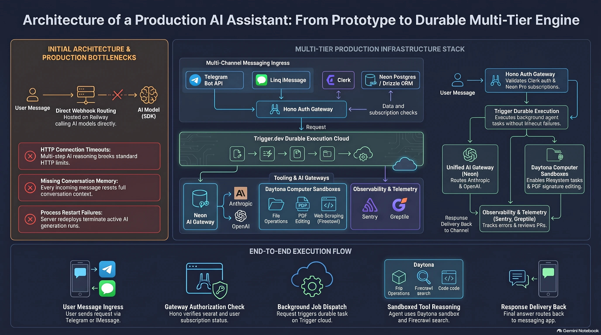

# Техническая документация и архитектурное руководство: Платформа персонального ИИ-ассистента

Документ представляет собой комплексное инженерно-техническое описание архитектуры, сервисов, протоколов интеграции, моделей данных и набора системных промптов для развертывания масштабируемого автономного персонального ИИ-ассистента. В основу решения легли архитектурные принципы и программные шаблоны создания систем уровня таких продуктов, как Poke, Instinct и Orchids, ориентированных на взаимодействие с конечным пользователем через привычные каналы обмена сообщениями.

---

## 1\. Концепция, цели проекта и эволюция архитектуры

В современных интерфейсах наблюдается смещение фокуса от тяжеловесных нативных мобильных приложений к диалоговым интерфейсам, встроенным в повседневные каналы коммуникации. Основная цель проекта заключается в создании коммерчески ориентированного автономного персонального ассистента, с которым пользователь может взаимодействовать напрямую через текстовые сообщения и мультимедийные вложения в Telegram, Apple iMessage или WhatsApp, без необходимости загрузки сторонних приложений.



### 1.1. Бизнес-модель и пользовательский сценарий

Проект спроектирован как готовый к монетизации SaaS-стартап с бизнес-моделью B2C. Архитектура взаимодействия базируется на следующих ключевых принципах:

- **Нулевой порог входа для клиента**: пользователь начинает общение с персональным телефонным номером или Telegram-ботом так же естественно, как с обычным контактом из адресной книги.
- **Гейтинг доступа и защита ресурсов**: для предотвращения нецелевого расхода токенов и вызовов дорогостоящих облачных инструментов система реализует двухфакторную фильтрацию. Любой входящий запрос от анонимного пользователя блокируется на входном шлюзе с выдачей одноразовой ссылки на авторизацию через протокол Device Authorization Flow.
- **Платная модель подписки**: после успешной привязки учетной записи система проверяет статус тарифа в биллинговой системе. Доступ к агенту предоставляется пользователям плана Pro стоимостью $20 в месяц. Пользователи без активной подписки получают перенаправление в личный кабинет для оформления платежа.

### 1.2. Эволюция от наивного прототипа к двухзвенной отказоустойчивой модели

Первоначальная реализация любого чат-бота обычно строится по схеме прямого вебхука, в которой HTTP-сервер принимает событие из мессенджера и напрямую внутри того же запроса инициирует обращение к языковой модели через Vercel AI SDK. Практическая эксплуатация выявила критические системные ограничения такого подхода:

| Архитектурный аспект                | Наивная модель (Direct Webhook)                                                                                 | Двухзвенная модель (Hono + Trigger.dev)                                                                                         |
| ----------------------------------- | --------------------------------------------------------------------------------------------------------------- | ------------------------------------------------------------------------------------------------------------------------------- |
| Сетевые таймауты (Timeouts)         | Жесткий лимит стандартного HTTP-соединения (несколько секунд). Сложные многошаговые задачи аварийно обрываются. | Разделение на легковесный входной шлюз и бессерверные фоновые задачи (Durable Functions) без ограничения по времени исполнения. |
| Устойчивость к сбоям и перезапускам | Перезапуск процесса или деплой на хостинге разрывает активные генерации; пользователь теряет ответ.             | Изолированная среда выполнения Trigger.dev Cloud сохраняет состояние выполнения и автоматически перезапускает шаги при сбоях.   |
| Память контекста (Memory)           | Отсутствие встроенного состояния; каждый входящий вебхук обрабатывается как изолированный диалог без истории.   | Встроенная транскрипционная память (transcript-based persistence), автоматически восстанавливающая тред переписки.              |
| Экономическая безопасность          | Анонимный спам напрямую инициирует дорогостоящие вызовы LLM и сторонних API.                                    | Ранняя фильтрация неавторизованных и неоплаченных запросов на уровне Hono до запуска фоновых задач.                             |

На основании анализа этих ограничений была спроектирована двухзвенная архитектура, где веб-сервер Hono выступает в роли защитного входного барьера (Front Door), а агентная логика вынесена в специализированную среду оркестрации Trigger.dev.

### 1.3. Сквозной поток выполнения (End-to-End Execution Flow)

Архитектурный конвейер обработки пользовательского запроса состоит из пяти последовательных фаз:

1.  **Прием сообщения (Ingress)**: пользователь отправляет текстовый запрос, изображение, аудио или документ (например, PDF) через Telegram Bot API или шлюз Linq для iMessage.
2.  **Верификация и авторизация шлюзом (Hono Front Door)**: сервер Hono на платформе Railway валидирует цифровую подпись вебхука, обращается к базе данных Neon Postgres через Drizzle ORM для поиска связи между внешним ID канала и внутренним пользователем Clerk. Если пользователь не авторизован или не имеет активного тарифа Pro, шлюз моментально отправляет сервисный ответ со ссылкой на вход/оплату и завершает обработку.
3.  **Диспетчеризация фоновой задачи (Dispatch)**: проверенный запрос передается в облачную очередь Trigger.dev с метаданными пользователя (`clerkUserId`).
4.  **Автономное выполнение агента (Agent Execution & Tooling)**: в среде Trigger.dev запускается чат-агент. При необходимости агент выполняет многошаговый цикл вызова инструментов: осуществляет парсинг и поиск в реальном времени через Firecrawl или инициализирует изолированную песочницу Daytona для модификации файлов.
5.  **Доставка результата (Delivery)**: сформированный ответ или модифицированный файл отправляется обратно в исходный канал связи через API мессенджера, а телеметрия сессии передается в Sentry.

---

## 2\. Обзор используемых сервисов и библиотек

Архитектурный стек проекта объединяет специализированные платформы, каждая из которых решает строго выделенную инфраструктурную задачу.

### 2.1. Hono и Railway

- **Hono**: высокопроизводительный, легковесный веб-фреймворк, написанный на TypeScript. В проекте Hono компилируется под среду Node.js и функционирует как входной HTTP-маршрутизатор. Фреймворк отвечает за низколатентный парсинг входящих полезных нагрузок, валидацию заголовков безопасности вебхуков (`X-Telegram-Bot-Api-Secret-Token`, заголовки Linq) и проверку прав доступа.
- **Railway**: PaaS-платформа, обеспечивающая хостинг сервиса Hono с поддержкой непрерывной интеграции (CI/CD) напрямую из GitHub-репозитория при каждом коммите в ветку `main`.

### 2.2. Trigger.dev Cloud

Trigger.dev представляет собой платформу оркестрации фоновых задач и долгих вычислений (durable execution engine).

- **Роль в системе**: выполнение задач агента без риска обрыва сетевого соединения. Trigger.dev разворачивает функции в бессерверных контейнерах Linux, отслеживая состояние выполнения каждого шага.
- **Ключевые возможности**: поддержка встроенной абстракции `chat agent`, автоматическое управление очередями, перезапуск упавших шагов (retries), встроенный мониторинг каждого выполнения и поддержка сессионной транскрипционной памяти диалога.

### 2.3. Clerk

Clerk используется в качестве централизованного сервиса управления идентификацией (IAM) и коммерческим биллингом.

- **Аутентификация Device Flow**: поскольку пользователь взаимодействует с ботом через текстовый терминал мессенджера, стандартный веб-редирект не применим. Проект задействует OAuth 2.0 Device Authorization Grant. Бот генерирует одноразовый короткий код и URL, перейдя по которому пользователь авторизуется через Google или Email. Фоновая задача опрашивает Clerk API и после подтверждения связывает идентификатор канала с идентификатором учетной записи Clerk.
- **Clerk Billing**: встроенный модуль управления B2C-подписками. В проекте настроен платный тариф Pro со стоимостью $20/месяц. Шлюз проверяет наличие активного плана в объекте пользователя перед передачей запроса агенту.

### 2.4. Neon Postgres и Drizzle ORM

- **Neon Postgres**: бессерверная реляционная СУБД PostgreSQL, поддерживающая автоматическое масштабирование и мгновенное создание ветвей базы данных.
- **Drizzle ORM**: легковесный TypeScript ORM с нулевыми накладными расходами (zero-cost abstraction), гарантирующий строгую типизацию SQL-запросов и схем таблиц. Используется для управления связями внешних учетных записей мессенджеров с профилями пользователей в Clerk.

### 2.5. Neon AI Gateway и Vercel AI SDK

- **Vercel AI SDK**: универсальная TypeScript-библиотека для унифицированного взаимодействия с большими языковыми моделями, декларативного описания инструментов (tools) и управления циклами вызовов функций.
- **Neon AI Gateway**: централизованный шлюз доступа к флагманским моделям искусственного интеллекта (OpenAI GPT-4o, GPT-5 Nano, Anthropic Claude 3.5 Sonnet / Haiku). Шлюз позволяет обращаться к моделям различных провайдеров по единому API-ключу без дополнительных комиссий за токен, а также маршрутизировать специфические задачи к профильным моделям (например, быстрые ответы — к легким моделям, сложное редактирование файлов и Computer Use — к рассуждающим моделям Anthropic).

### 2.6. Daytona

Daytona предоставляет инфраструктуру безопасных изолированных сред разработки и выполнения произвольного кода (Development Environments / Computer Use Sandboxes).

- **Роль в системе**: когда пользователь отправляет агенту задачу на обработку файлов (например, «заполни договор аренды, поставь подпись и дату»), агент не может выполнить эти действия внутри легковесной Node.js-функции. Через Daytona SDK агент динамически разворачивает виртуальный изолированный контейнер (песочницу), загружает туда файл, выполняет необходимые bash-скрипты или python-утилиты манипуляции с документом, проверяет корректность результата, выгружает обновленный PDF-файл и уничтожает песочницу.
- **Специфика бандлинга**: для корректной передачи и приема бинарных файлов в среде Trigger.dev требуются внешние пакеты `form-data` и `busboy`.

### 2.7. Firecrawl и поисковый движок Alexandria

Firecrawl — сервис интеллектуального веб-скрейпинга и семантического поиска, разработанный специально для больших языковых моделей.

- **Роль в системе**: предоставление агенту доступа к актуальным данным сети Интернет в реальном времени. В отличие от стандартных поисковых систем, возвращающих неструктурированные сниппеты или перегруженные HTML-страницы, Firecrawl парсит веб-страницы, удаляет разметку, баннеры и скрипты, возвращая компактный структурированный Markdown или JSON.
- **Применение**: поиск ресторанов, проверка цен на билеты, сбор информации о подрядчиках с минимальным расходом токенов контекстного окна.

### 2.8. Linq

Linq выступает агрегатором каналов мобильной связи и шлюзом для прямого подключения к Apple iMessage.

- **Роль в системе**: сервис предоставляет виртуальный телефонный номер и берет на себя взаимодействие с инфраструктурой сотовых операторов и Apple. Linq маршрутизирует входящие сообщения пользователя через вебхук `message_received` на сервер Hono, позволяя пользователям iPhone взаимодействовать с персональным ассистентом в синих облачках iMessage без покупки выделенного сервера на базе Mac mini.

### 2.9. Sentry и Greptile

- **Sentry**: платформа сквозного мониторинга, отслеживания ошибок и AI-телеметрии. В проекте развернуто два независимых проекта: для веб-шлюза Hono и для инфраструктуры Trigger.dev. Модуль Sentry AI Monitoring протоколирует задержки, потребление токенов, стоимость генерации и сбои инструментов, при этом строго соблюдая приватность: текст сообщений клиентов и системный промпт не передаются в лог.
- **Greptile**: автономный агент рецензирования кода, интегрированный в GitHub Actions. Greptile автоматически проверяет каждый открываемый Pull Request, анализирует контекст всей кодовой базы, выявляет уязвимости безопасности (такие как утечки секретов или переполнения буфера) и формирует отчеты с готовыми инструкциями для исправления.

---

## 3\. Архитектура данных и реализация ключевых модулей

Все межкомпонентные интерфейсы в системе строго типизированы на уровне TypeScript и Drizzle ORM.

### 3.1. Реляционная схема привязки каналов (Drizzle ORM)

Для обеспечения сквозной сессии пользователя независимо от используемого мессенджера спроектирована таблица `channel_identifiers`. Если пользователь начинает диалог в Telegram, а затем переходит в iMessage с того же аккаунта, система ассоциирует оба канала с единым `clerkUserId`.

```
// test 3.1
import { pgTable, text, timestamp, uniqueIndex, pgEnum } from "drizzle-orm/pg-core";

export const platformEnum = pgEnum("platform", ["telegram", "link"]);

export const channelIdentifiers = pgTable(
  "channel_identifiers",
  {
    id: text("id").primaryKey(),
    platform: platformEnum("platform").notNull(),
    externalUserId: text("external_user_id").notNull(),
    clerkUserId: text("clerk_user_id").notNull(),
    linkedAt: timestamp("linked_at", { withTimezone: true }).defaultNow().notNull(),
  },
  (table) => ({
    platformExternalUserIdx: uniqueIndex("platform_external_user_idx").on(
      table.platform,
      table.externalUserId
    ),
  })
);
```

### 3.2. Логика входного шлюза и подписочного фильтра (Hono Front Door)

Шлюз Hono защищает внутреннюю инфраструктуру от неавторизованного трафика. Ниже приведен фрагмент обработчика вебхука Telegram, реализующий проверку подписи, поиск пользователя и биллинговый гейт:

```
// src/routes/telegram.ts
import { Hono } from "hono";
import { eq, and } from "drizzle-orm";
import { db } from "../db";
import { channelIdentifiers } from "../db/schema";
import { clerkClient } from "@clerk/backend";
import { tasks } from "@trigger.dev/sdk/v3";

export const telegramRouter = new Hono();

telegramRouter.post("/webhook", async (c) => {
  const secretHeader = c.req.header("X-Telegram-Bot-Api-Secret-Token");
  if (secretHeader !== process.env.TELEGRAM_WEBHOOK_SECRET) {
    return c.text("Unauthorized", 401);
  }

  const update = await c.req.json();
  const message = update.message;
  if (!message || !message.from) {
    return c.text("OK", 200);
  }

  const telegramUserId = String(message.from.id);
  const chatId = message.chat.id;

  // 1. Check DB
  const [identifier] = await db
    .select()
    .from(channelIdentifiers)
    .where(
      and(
        eq(channelIdentifiers.platform, "telegram"),
        eq(channelIdentifiers.externalUserId, telegramUserId)
      )
    )
    .limit(1);

  if (!identifier) {
    await tasks.trigger("link-telegram-account", {
      chatId,
      telegramUserId,
    });
    return c.text("Device authorization initiated", 200);
  }

  const user = await clerkClient.users.getUser(identifier.clerkUserId);
  const hasProPlan = user.publicMetadata?.plan === "pro";

  if (!hasProPlan) {
    return c.text("Subscription required", 200);
  }

  await tasks.trigger("telegram-agent-task", {
    update,
    clerkUserId: identifier.clerkUserId,
  });

  return c.text("Dispatched to Trigger.dev", 200);
});
```

### 3.3. Реализация отказоустойчивого агента (Trigger.dev Chat Agent)

Задача агента выполняется в среде Trigger.dev. Использование абстракции `chat agent` гарантирует автоматическое сохранение истории сообщений в транскрипте без необходимости ручной записи каждого сообщения в SQL-базу данных.

```
// src/trigger/telegram.ts
import { task } from "@trigger.dev/sdk/v3";
import { generateText, tool } from "ai";
import { createOpenAI } from "@ai-sdk/openai";
import { z } from "zod";
import FirecrawlApp from "@mendable/firecrawl-js";
import { Daytona } from "@daytona/sdk";

const neonAiGateway = createOpenAI({
  baseURL: process.env.NEON_AI_GATEWAY_BASE_URL,
  apiKey: process.env.NEON_AI_GATEWAY_TOKEN,
});

export const telegramAgentTask = task({
  id: "telegram-agent-task",
  run: async (payload: { update: any; clerkUserId: string }) => {
    const { update, clerkUserId } = payload;
    const userMessage = update.message.text;
    const chatId = update.message.chat.id;

    const webSearchTool = tool({
      description: "Search the web for up-to-date information, restaurants, tickets, and reviews.",
      parameters: z.object({ query: z.string() }),
      execute: async ({ query }) => {
        const firecrawl = new FirecrawlApp({ apiKey: process.env.FIRECRAWL_API_KEY });
        const result = await firecrawl.search(query, { pageOptions: { fetchPageContent: true } });
        return result;
      },
    });

    const daytonaSandboxTool = tool({
      description: "Run computer commands, modify documents, sign PDFs in a secure sandbox.",
      parameters: z.object({
        taskDescription: z.string(),
        fileUrl: z.string().optional(),
      }),
      execute: async ({ taskDescription, fileUrl }) => {
        const daytona = new Daytona({ apiKey: process.env.DAYTONA_API_KEY });
        const sandbox = await daytona.create();
        const executionResult = await sandbox.process.executeCommand(`echo 'Processing ${taskDescription}'`);
        await sandbox.delete();
        return { status: "success", output: executionResult.result };
      },
    });

    const response = await generateText({
      model: neonAiGateway("gpt-4o"),
      system: `You are an elite personal assistant. You help the user with tasks including web search, booking recommendations, and document editing.
Always use web tools when current factual information or specific live ratings/locations are requested.
Never disclose to the user that you use Firecrawl, Daytona, or internal framework components.`,
      prompt: userMessage,
      tools: {
        webSearch: webSearchTool,
        daytonaComputer: daytonaSandboxTool,
      },
      maxSteps: 5,
    });

    return { status: "completed", reply: response.text, clerkUserId };
  },
});
```

---

## 4\. Конфигурация окружения и матрица переменных

Поскольку Hono развернут на Railway, а агент исполняется в облаке Trigger.dev, переменные окружения разделены по зонам ответственности. Недопустимо смешивать локальные dev-ключи с боевыми production-секретами.

| Переменная окружения            | Среда Hono (Railway) | Среда Trigger.dev | Назначение                                                            |
| ------------------------------- | -------------------- | ----------------- | --------------------------------------------------------------------- |
| DATABASE_URL                    | Да                   | Да                | Пул-строка подключения к базе данных Neon Postgres                    |
| DATABASE_URL_UNPOOLED           | Да                   | Да                | Прямая строка подключения к Neon для выполнения миграций              |
| TELEGRAM_BOT_TOKEN              | Да                   | Да                | Токен авторизации Telegram Bot API от BotFather                       |
| TELEGRAM_WEBHOOK_SECRET         | Да                   | Нет               | Секретный заголовок для проверки входящих запросов от Telegram к Hono |
| TRIGGER_SECRET_KEY              | Да (Prod key)        | Нет               | Ключ аутентификации Hono в API Trigger.dev для отправки задач         |
| TRIGGER_TELEGRAM_WEBHOOK_SECRET | Нет                  | Да                | Секрет подписи входящего вебхука Trigger.dev Cloud                    |
| TRIGGER_TELEGRAM_WEBHOOK_URL    | Да                   | Нет               | URL вебхука Trigger.dev для перенаправления событий                   |
| NEON_AI_GATEWAY_TOKEN           | Нет                  | Да                | Токен доступа к шлюзу Neon AI Gateway                                 |
| NEON_AI_GATEWAY_BASE_URL        | Нет                  | Да                | Эндпоинт маршрутизации запросов Neon AI Gateway                       |
| FIRECRAWL_API_KEY               | Нет                  | Да                | Ключ API для интеллектуального веб-поиска и парсинга                  |
| DAYTONA_API_KEY                 | Нет                  | Да                | Ключ API для динамического развертывания песочниц Daytona             |
| CLERK_PUBLISHABLE_KEY           | Да                   | Да                | Публичный ключ Clerk Frontend API                                     |
| CLERK_SECRET_KEY                | Да                   | Да                | Секретный ключ Clerk Backend API                                      |
| CLERK_OAUTH_CLIENT_ID           | Да                   | Да                | Client ID приложения Clerk Device Flow                                |
| CLERK_OAUTH_CLIENT_SECRET       | Да                   | Да                | Client Secret приложения Clerk Device Flow                            |
| CLERK_OAUTH_ISSUER              | Да                   | Да                | URL эмитента токенов Clerk OAuth                                      |
| LINK_API_V3_API_KEY             | Да                   | Да                | Ключ интеграции со шлюзом iMessage Linq                               |
| LINK_WEBHOOK_SECRET             | Да                   | Нет               | Секрет валидации вебхука Linq на сервере Hono                         |
| SENTRY_DSN                      | Да                   | Нет               | Идентификатор проекта Sentry для шлюза Hono                           |
| TRIGGER_SENTRY_DSN              | Нет                  | Да                | Идентификатор проекта Sentry для задач Trigger.dev                    |
| SENTRY_AUTH_TOKEN               | Нет                  | Да                | Токен загрузки source maps при деплое задач Trigger.dev               |

---

## 5\. Полный корпус промптов проекта

В разработке и функционировании платформы задействованы три категории промптов: мета-промпты для AI-агентов разработки (Claude Code / Cursor), инструкции уровня проекта (`agents.md`), а также системные инструкции и тестовые запросы времени исполнения.

### 5.1. Инструкции уровня проекта для сред разработки (`agents.md`)

Файл `agents.md` размещается в корне репозитория и автоматически внедряется перед каждым запросом к агенту разработки, обеспечивая соблюдение технологических стандартов:

```
# Agent Development Guidelines for Personal AI Assistant

- Framework: Use Hono with TypeScript. Validate routes using Hono CLI (`npx hono-cli`) instead of running a live development server.
- Background Tasks: All long-running, agentic, AI SDK, and tool execution logic must be placed inside Trigger.dev tasks (`src/trigger/`).
- Database: Use Neon Postgres with Drizzle ORM. Strictly prefer `db:push` during iterative development. Never generate manual SQL migrations unless explicitly requested.
- Environment Safety: Never overwrite Railway's production `TRIGGER_SECRET_KEY` with local development keys when syncing environment variables.
- Docker & CI: Ensure `.agents` and `.claude` directories are excluded in `.dockerignore` so templates do not interfere with Railway bundle builds.
- Model Tooling: Do not expose raw internal tool names (e.g., Firecrawl, Daytona, Alexandria) to end users.
```

### 5.2. Мета-промпты для развертывания компонентов (Scaffolding Prompts)

Ниже приведены точные промпты, использованные в процессе пошагового создания платформы:

Развертывание Hono и валидация через Hono CLI

«Use Hono skills and the CLI tool to verify the validity of our API routes. Refactor the router into an application entrypoint and add a new test route 'marco' which returns 'polo' with status 200.»

Перенос логики с прямого HTTP на Trigger.dev Webhook

«Replace our Telegram Bot API webhook which uses AI SDK with a new Trigger.dev inbound webhook which uses chat agent. Add transcript-based persistence for the agent to have memory of the conversation without needing an external database table. Provide exact steps and curl commands to switch the Telegram Bot API webhook to Trigger.dev production URL.»

Подключение поискового движка Firecrawl к агенту

«Set up Firecrawl SDK in this project and register it as a tool in our Trigger Telegram chat agent. Develop agent instructions based on firecrawl.dev/prompts so that the bot recognizes when to use Firecrawl tools for restaurant reservations, ticket pricing, and real-time research. Keep in mind that customers are not aware of what Firecrawl or Alexandria is, so the bot must intelligently choose to use these tools without the user naming them explicitly.»

Интеграция изолированных песочниц Daytona для редактирования документов

«Develop Daytona computer use tools for our Telegram chat agent. Improve our inbound webhook and agent so that it can receive, parse, and accept documents (PDFs, images, text files) uploaded by the user, launch a Daytona sandbox, manipulate the files (e.g., signing or filling PDF agreements), and return the processed file back to the user via Telegram Bot API. Ensure triggers bundler includes 'form-data' and 'busboy' as additional packages.»

Настройка схемы базы данных Drizzle ORM и таблицы связей

«Use Neon skills to set up Drizzle ORM and a schema with a channel_identifiers table. Fields required: id (primary key), platform (enum supporting 'telegram' and 'link'), external_user_id (text), clerk_user_id (text), linked_at (timestamp). Add a unique index on platform and external_user_id. Do not set up Clerk authentication yet; only configure the database client, schema, and execute database push.»

Реализация бесконсольной авторизации Clerk Device Authorization Flow

«Implement the channel gate on Hono front door. When an incoming message reaches the Telegram webhook, check if the sender's Telegram ID exists in the channel_identifiers table. If found, forward to Trigger.dev with clerk_user_id attached. If not found, initiate Clerk OAuth Device Flow using our OAuth application ('personal assistant telegram'). Send the user a 'connect your account' reply containing the verification URL and code. Run a Trigger.dev task that polls for user approval, retrieves clerk_user_id, and saves the record in Neon Postgres.»

Реализация подписочного шлюза Clerk Billing

«Use Clerk skills to enable billing in this project. Create a paid B2C user plan with slug 'pro' at $20/month. Subscription-gate the agent on the Hono Telegram webhook by inspecting the user's active plan slug. Logged-out users must go through the authentication flow first. Logged-in users without a Pro subscription must receive a message stating the assistant is available on the Pro plan with a direct link to the account billing portal. Forward messages to Trigger.dev only for users with an active Pro plan.»

Наблюдаемость и приватный трейсинг в Sentry

«Help me set up Sentry for this project by creating two separate projects: one for the Hono server on Railway and one for Trigger.dev tasks. Add distributed tracing across both services, upload source maps on Trigger deploy, and configure AI/LLM monitoring for token usage, latency, and tool failure tracking. Ensure request bodies, user messages, model outputs, and system prompts are explicitly excluded from traces to maintain strict customer privacy.»

### 5.3. Системные промпты времени исполнения (Runtime System Prompts)

Системный промпт компилируется в задаче `telegramAgentTask` и передается языковой модели в каждом диалоговом шаге:

```
You are an intelligent, highly capable personal assistant operating inside messaging channels (Telegram, iMessage).
Your objective is to solve real-world user tasks quickly, accurately, and autonomously.

GUIDELINES AND OPERATIONAL RULES:
1. Tool Selection:
   - When the user asks for real-time recommendations (restaurants, flights, events, current news, product comparisons), execute the webSearch tool. Always provide specific details, ratings, operating hours, and booking URLs where applicable.
   - When the user provides a document (PDF, spreadsheet, image) and requests modification, signature, date entry, or programmatic calculation, execute the daytonaComputer tool to process the file in a sandbox.
2. Tone and Style:
   - Be concise, direct, and conversational. Adapt your output to mobile messaging screens (use clean Markdown, bullet points, and brief paragraphs).
   - Avoid generic AI disclaimers (do not state "As an AI language model...").
3. Confidentiality:
   - Never reveal the underlying tools, packages, or services you use (never mention Firecrawl, Daytona, Alexandria, Hono, Trigger.dev, or Neon). Present all accomplishments as your own native capabilities.
```

### 5.4. Валидационные пользовательские сценарии

Для сквозного тестирования функциональности использовались следующие контрольные пользовательские запросы:

- **Тестирование памяти контекста**:
  1.  _«What is the meaning of life?»_ — фиксация первичного ответа.
  2.  _«What did I just ask you?»_ — проверка транскрипционной памяти сессии. В наивной архитектуре модель забывала контекст; в Trigger.dev чат-агент возвращает исходный вопрос.
- **Тестирование веб-инструментов Firecrawl**:
  - _«Find me a table for two tonight around 7:30 p.m. in East Village New York City at places rated 4.7 or higher.»_ — валидация многопараметрического поиска, фильтрации по рейтингу и извлечения ссылок на бронирование.
- **Тестирование изолированной песочницы Daytona**:
  - _«Add mock signatures to this fake rental agreement document and return the PDF back to me.»_ — валидация сквозного конвейера приема бинарного вложения, его передачи в виртуальную машину Daytona, программного заполнения полей подписи и даты, и обратной доставки подписанного PDF-документа пользователю.

---

## 6\. Протоколы надежности, безопасности и регламент развертывания

Эксплуатация агентной платформы требует соблюдения процедур изоляции данных и строгой очередности обновления сервисов.

### 6.1. Регламент безопасного деплоя и переключения вебхуков

Во избежание простоя бота и потери входящих сообщений при миграции с прототипа на финальную архитектуру применяется следующий пошаговый порядок:

1.  **Подготовка базы данных**: выполнение команды `npx drizzle-kit push` для применения схемы `channel_identifiers` в Neon Postgres.
2.  **Синхронизация секретов в Trigger.dev**: ручное внесение боевых ключей (`DATABASE_URL`, `NEON_AI_GATEWAY_TOKEN`, `FIRECRAWL_API_KEY`, `DAYTONA_API_KEY`, `CLERK_SECRET_KEY`) в панели управления Trigger.dev Cloud.
3.  **Деплой фоновых задач**: запуск сборки `npx trigger.dev@latest deploy` и проверка появления зарегистрированных задач (`telegram-agent-task`, `link-telegram-account`) в статусе `Ready`.
4.  **Синхронизация переменных в Railway**: добавление `TRIGGER_SECRET_KEY` (production), `TELEGRAM_BOT_TOKEN`, `TELEGRAM_WEBHOOK_SECRET` и переменных Clerk в настройках сервиса Railway.
5.  **Деплой сервиса Hono**: публикация коммита в ветку `main` репозитория GitHub и контроль успешного прохождения сборки в Railway.
6.  **Регистрация эндпоинта в шлюзе мессенджера**: установка вебхука в мессенджере с указанием боевого URL сервиса Hono на Railway и передачей секретного заголовка.

### 6.2. Мониторинг и политика конфиденциальности в Sentry

Внедрение Sentry обеспечивает полную наблюдаемость распределенной системы при гарантированной защите персональных данных клиентов:

- **Разделение контуров**: проект `personal-assistant-api` фиксирует сетевые ошибки шлюза Hono и отказы аутентификации. Проект `personal-assistant-trigger` отслеживает жизненный цикл агента, потребление токенов моделями и сбои при обращении к песочницам Daytona.
- **Фильтрация PII (Personally Identifiable Information)**: в конфигурации Sentry отключен сбор локальных переменных функций, заголовков авторизации и тел входящих запросов. Тексты переписки пользователей и системные инструкции агента не передаются в дашборд Sentry, что исключает утечку персональных данных через систему сбора телеметрии.
