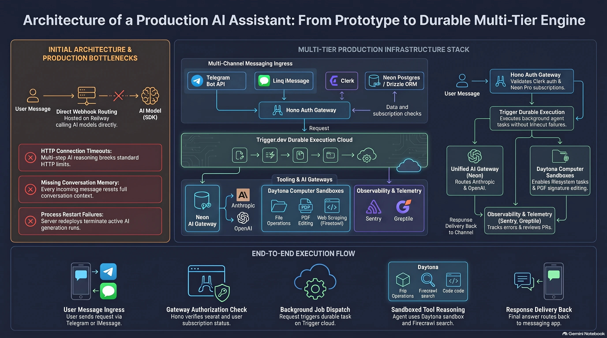

# Technical Documentation and Architecture Guide: Personal AI Assistant Platform

This document provides a comprehensive engineering and architectural reference for designing, deploying, and operating a scalable, production-grade autonomous personal AI assistant. The system architecture embodies the engineering principles and design patterns seen in commercial messaging-first AI products such as Poke, Instinct, and Orchids, delivering an intelligent agent directly into everyday communication channels without requiring standalone client applications.

---

## 1\. Project Concept, Strategic Objectives, and Architectural Evolution

Modern consumer interaction patterns are rapidly shifting away from heavyweight native mobile apps toward conversational interfaces embedded in daily communication tools. The primary objective of this project is to build an autonomous, commercially viable personal AI assistant accessible directly via text messages, voice notes, and file attachments in messaging ecosystems such as Telegram, Apple iMessage, and WhatsApp.



### 1.1. Business Model and Consumer Journey

The platform is designed as a production-ready, monetization-focused B2C SaaS architecture. The user interaction lifecycle adheres to three core design tenets:

- **Frictionless Onboarding**: A user initiates conversation with a dedicated virtual telephone number or Telegram bot as naturally as chatting with an existing address book contact.
- **Access Gating and Resource Protection**: To prevent unauthorized token consumption and protect expensive cloud tool execution, the system implements a strict multi-tier access gate. Inbound requests from unrecognized channel identifiers are intercepted at the ingress boundary and routed to an out-of-band authentication flow via the OAuth 2.0 Device Authorization Grant.
- **Subscription-Based Monetization**: Once account ownership is verified, the system inspects the user profile for active subscription entitlements. Agent execution is restricted to users enrolled in an active Pro tier ($20/month). Unsubscribed or past-due accounts receive a localized service message with a direct link to the customer billing portal.

### 1.2. Evolution from Naive Prototype to Resilient Two-Tier Architecture

Initial chatbot prototypes typically adopt a direct webhook topology, where the HTTP ingress server receives an event from a messenger and processes the large language model invocation synchronously within the open request cycle via the Vercel AI SDK. Operational experience demonstrates severe systemic bottlenecks with this naive approach:

| Architectural Dimension      | Naive Model (Direct Webhook)                                                                                                            | Two-Tier Model (Hono + Trigger.dev)                                                                                                         |
| ---------------------------- | --------------------------------------------------------------------------------------------------------------------------------------- | ------------------------------------------------------------------------------------------------------------------------------------------- |
| Network Timeouts             | Bound by strict standard HTTP connection limits (a few seconds). Complex multi-step tool calls drop prematurely.                        | Ingress is decoupled into a lightweight front door and serverless background tasks (Durable Functions) without execution duration ceilings. |
| Fault Tolerance and Restarts | Process restarts or hosting deploys abort active generations mid-stream; users receive dropped or incomplete responses.                 | Isolated Trigger.dev Cloud execution checkpointing preserves execution state and automatically resumes interrupted steps.                   |
| Context Memory               | Lacks built-in persistent state; every inbound webhook is treated as an isolated turn unless hand-rolled database queries are executed. | Native transcript-based persistence automatically reconstructs conversational threads across sessions without custom SQL tables.            |
| Cost Protection              | Unauthenticated spam directly triggers expensive model inference and third-party API invocations.                                       | Front door validation filters anonymous and delinquent requests at the Hono boundary before triggering background tasks.                    |

To overcome these structural limitations, the platform adopts a decoupled two-tier architecture: a lightweight Hono web service acts as a protective Front Door, while agent reasoning and compute-heavy tool executions run inside Trigger.dev Cloud.

### 1.3. End-to-End Execution Flow

The end-to-end request lifecycle progresses across five coordinated stages:

1.  **Message Ingress**: The user sends a text query, image, voice note, or document (e.g., a PDF agreement) via the Telegram Bot API or the Linq gateway for Apple iMessage.
2.  **Ingress Gateway Verification (Hono Front Door)**: Hosted on Railway, the Hono gateway validates webhook digital signatures, queries Neon Postgres via Drizzle ORM to resolve the mapping between the channel-specific sender ID and an internal Clerk user record. Unauthenticated users receive an instant pairing link; accounts without an active Pro plan receive a subscription prompt.
3.  **Background Task Dispatch**: Validated, entitled requests are immediately enqueued into Trigger.dev Cloud with the authenticated `clerkUserId` attached as payload metadata. The HTTP webhook responds with a 200 OK status in under 100 milliseconds.
4.  **Autonomous Agent Execution and Tool Orchestration**: Inside Trigger.dev Cloud, the durable chat agent executes. When required, the agent orchestrates multi-step tool loops: performing real-time semantic web crawls via Firecrawl or provisioning ephemeral Daytona virtual computer environments to execute sandboxed document modifications.
5.  **Egress Delivery**: The synthesized response or modified document artifact is transmitted back to the original messaging channel via the messenger API, while distributed tracing and token telemetry are forwarded to Sentry.

---

## 2\. Infrastructure Services and Library Ecosystem

The architecture integrates best-in-class specialized managed services, each assigned to a strictly defined infrastructure role.

### 2.1. Hono and Railway

- **Hono**: A lightweight, high-performance web framework authored in TypeScript. In this architecture, Hono runs on the Node.js runtime as an edge-ready HTTP router. It handles low-latency parsing of inbound payloads, enforces webhook security headers (`X-Telegram-Bot-Api-Secret-Token`, Linq signature headers), and manages authentication verification before dispatching tasks.
- **Railway**: A Platform-as-a-Service (PaaS) hosting provider managing continuous deployment (CI/CD) for the Hono ingress service with automated build pipelines triggered on repository commits to the `main` branch.

### 2.2. Trigger.dev Cloud

Trigger.dev serves as the durable execution engine and background job orchestration platform.

- **System Role**: Executes long-running agent workflows without risking network dropouts. Trigger.dev runs background jobs inside managed serverless Linux environments, tracking the lifecycle and deterministic completion of each step.
- **Core Capabilities**: Built-in chat agent abstractions, automatic queue concurrency management, configurable step-level retries, execution-level telemetry, and native transcript-based memory management.

### 2.3. Clerk

Clerk provides centralized Identity and Access Management (IAM) and integrated B2C customer billing.

- **Device Authorization Flow**: Because conversational interactions occur inside headless text messengers, standard browser-based OAuth redirects cannot be used directly. The system utilizes the OAuth 2.0 Device Authorization Grant. The bot issues a short single-use code and authentication URL; the user verifies identity in a mobile browser via Google or Email. A polling task in Trigger.dev resolves the `clerkUserId` and links it to the messenger profile.
- **Clerk Billing**: Manages paid B2C subscription tiers. The platform enforces an active subscription to the Pro plan ($20/month) before allowing requests to enter the agent orchestration layer.

### 2.4. Neon Postgres and Drizzle ORM

- **Neon Postgres**: A serverless, auto-scaling PostgreSQL relational database featuring compute separation and instant database branching.
- **Drizzle ORM**: A zero-overhead, type-safe TypeScript Object-Relational Mapper ensuring schema safety across SQL queries. It manages persistent mappings between disparate messaging channel IDs and unified Clerk user records.

### 2.5. Neon AI Gateway and Vercel AI SDK

- **Vercel AI SDK**: The standard TypeScript framework for declarative model interactions, structured tool definitions, and autonomous function calling loops.
- **Neon AI Gateway**: A centralized proxy and caching layer for accessing frontier large language models (OpenAI GPT-4o, GPT-5 Nano, Anthropic Claude 3.5 Sonnet / Haiku). The gateway allows multiple model families to be consumed through a single unified token and endpoint without vendor markups, enabling dynamic routing of rapid conversational turns to lightweight models and complex file editing or computer tasks to reasoning models.

### 2.6. Daytona

Daytona delivers automated, secure development environments and isolated computer execution sandboxes.

- **System Role**: When a user submits complex tasks requiring programmatic file modifications (e.g., filling out and signing PDF contracts, processing spreadsheets, or running scripts), code cannot run inside a transient serverless function. Through the Daytona SDK, the agent dynamically spins up an isolated Linux container sandbox, transfers the user asset, executes bash or Python manipulation utilities, verifies output integrity, retrieves the finalized PDF, and terminates the container.
- **Bundler Configuration**: To support binary file streams and multipart form data within Trigger.dev tasks, the task bundler explicitly includes `form-data` and `busboy`.

### 2.7. Firecrawl and Alexandria Search Engine

Firecrawl is an intelligent web scraping, crawling, and semantic search engine engineered specifically for large language models.

- **System Role**: Supplies the agent with real-time, ground-truth web knowledge. Unlike conventional search APIs that return unstructured snippets or bloated raw HTML, Firecrawl traverses pages, strips extraneous DOM elements, scripts, and advertisements, and returns clean, token-efficient Markdown or structured JSON.
- **Target Workloads**: Restaurant table discovery, live event scheduling, flight and ticket pricing, and market research with minimal context window overhead.

### 2.8. Linq

Linq provides cellular messaging infrastructure and carrier gateway integration for Apple iMessage connectivity.

- **System Role**: Allocates virtual phone numbers and bridges communication with Apple iMessage servers. Linq forwards inbound `message_received` webhooks to the Hono gateway, allowing iOS users to interact with the assistant in native blue-bubble threads without requiring dedicated local Mac mini hardware.

### 2.9. Sentry and Greptile

- **Sentry**: Comprehensive distributed tracing, application error monitoring, and AI session telemetry. The platform maintains two isolated projects: one for the Hono web gateway and one for Trigger.dev background tasks. The Sentry AI Monitoring integration logs latency, token consumption, operational costs, and tool failure rates while enforcing strict data hygiene: customer message contents and system prompts are explicitly excluded from traces.
- **Greptile**: An autonomous codebase review agent integrated into GitHub pull request workflows. Greptile reviews pull requests against the full architectural context of the repository, identifying security vulnerabilities, secret leaks, and architectural anti-patterns before changes merge into production.

---

## 3\. Data Architecture and Module Implementation

All inter-service boundaries in the system are strictly typed using TypeScript and Drizzle ORM schemas.

### 3.1. Relational Channel Mapping Schema (Drizzle ORM)

To preserve continuous user identity across multiple messaging platforms, the `channel_identifiers` table maps external identifiers to an internal `clerkUserId`. A user initiating a dialogue in Telegram and subsequently transitioning to iMessage is resolved to the same underlying profile and memory thread.

```
import { pgTable, text, timestamp, uniqueIndex, pgEnum } from "drizzle-orm/pg-core";

export const platformEnum = pgEnum("platform", ["telegram", "link"]);

export const channelIdentifiers = pgTable(
  "channel_identifiers",
  {
    id: text("id").primaryKey(),
    platform: platformEnum("platform").notNull(),
    externalUserId: text("external_user_id").notNull(),
    clerkUserId: text("clerk_user_id").notNull(),
    linkedAt: timestamp("linked_at", { withTimezone: true }).defaultNow().notNull(),
  },
  (table) => ({
    platformExternalUserIdx: uniqueIndex("platform_external_user_idx").on(
      table.platform,
      table.externalUserId
    ),
  })
);
```

### 3.2. Ingress Gateway and Subscription Gate (Hono Front Door)

The Hono ingress router shields background compute infrastructure from unauthenticated traffic. Below is an implementation of the Telegram webhook handler incorporating signature verification, account resolution, and subscription enforcement:

```
// src/routes/telegram.ts
import { Hono } from "hono";
import { eq, and } from "drizzle-orm";
import { db } from "../db";
import { channelIdentifiers } from "../db/schema";
import { clerkClient } from "@clerk/backend";
import { tasks } from "@trigger.dev/sdk/v3";

export const telegramRouter = new Hono();

telegramRouter.post("/webhook", async (c) => {
  const secretHeader = c.req.header("X-Telegram-Bot-Api-Secret-Token");
  if (secretHeader !== process.env.TELEGRAM_WEBHOOK_SECRET) {
    return c.text("Unauthorized", 401);
  }

  const update = await c.req.json();
  const message = update.message;
  if (!message || !message.from) {
    return c.text("OK", 200);
  }

  const telegramUserId = String(message.from.id);
  const chatId = message.chat.id;

  // 1. Resolve channel identity against database
  const [identifier] = await db
    .select()
    .from(channelIdentifiers)
    .where(
      and(
        eq(channelIdentifiers.platform, "telegram"),
        eq(channelIdentifiers.externalUserId, telegramUserId)
      )
    )
    .limit(1);

  if (!identifier) {
    await tasks.trigger("link-telegram-account", {
      chatId,
      telegramUserId,
    });
    return c.text("Device authorization initiated", 200);
  }

  // 2. Validate subscription entitlements via Clerk
  const user = await clerkClient.users.getUser(identifier.clerkUserId);
  const hasProPlan = user.publicMetadata?.plan === "pro";

  if (!hasProPlan) {
    return c.text("Subscription required", 200);
  }

  // 3. Dispatch execution to durable background task
  await tasks.trigger("telegram-agent-task", {
    update,
    clerkUserId: identifier.clerkUserId,
  });

  return c.text("Dispatched to Trigger.dev", 200);
});
```

### 3.3. Durable Chat Agent Implementation (Trigger.dev Chat Agent)

The autonomous agent executes within Trigger.dev Cloud. Utilizing the `chat agent` abstraction ensures conversation history is preserved across turns via transcript persistence without requiring bespoke message history tables.

```
// src/trigger/telegram.ts
import { task } from "@trigger.dev/sdk/v3";
import { generateText, tool } from "ai";
import { createOpenAI } from "@ai-sdk/openai";
import { z } from "zod";
import FirecrawlApp from "@mendable/firecrawl-js";
import { Daytona } from "@daytona/sdk";

const neonAiGateway = createOpenAI({
  baseURL: process.env.NEON_AI_GATEWAY_BASE_URL,
  apiKey: process.env.NEON_AI_GATEWAY_TOKEN,
});

export const telegramAgentTask = task({
  id: "telegram-agent-task",
  run: async (payload: { update: any; clerkUserId: string }) => {
    const { update, clerkUserId } = payload;
    const userMessage = update.message.text;
    const chatId = update.message.chat.id;

    const webSearchTool = tool({
      description: "Search the web for up-to-date information, restaurants, tickets, and reviews.",
      parameters: z.object({ query: z.string() }),
      execute: async ({ query }) => {
        const firecrawl = new FirecrawlApp({ apiKey: process.env.FIRECRAWL_API_KEY });
        const result = await firecrawl.search(query, { pageOptions: { fetchPageContent: true } });
        return result;
      },
    });

    const daytonaSandboxTool = tool({
      description: "Run computer commands, modify documents, sign PDFs in a secure sandbox.",
      parameters: z.object({
        taskDescription: z.string(),
        fileUrl: z.string().optional(),
      }),
      execute: async ({ taskDescription, fileUrl }) => {
        const daytona = new Daytona({ apiKey: process.env.DAYTONA_API_KEY });
        const sandbox = await daytona.create();
        const executionResult = await sandbox.process.executeCommand(`echo 'Processing ${taskDescription}'`);
        await sandbox.delete();
        return { status: "success", output: executionResult.result };
      },
    });

    const response = await generateText({
      model: neonAiGateway("gpt-4o"),
      system: `You are an elite personal assistant. You help the user with tasks including web search, booking recommendations, and document editing.
Always use web tools when current factual information or specific live ratings/locations are requested.
Never disclose to the user that you use Firecrawl, Daytona, or internal framework components.`,
      prompt: userMessage,
      tools: {
        webSearch: webSearchTool,
        daytonaComputer: daytonaSandboxTool,
      },
      maxSteps: 5,
    });

    return { status: "completed", reply: response.text, clerkUserId };
  },
});
```

---

## 4\. Environment Configuration and Secret Management

Because the ingress service runs on Railway while agent execution takes place in Trigger.dev Cloud, secrets and environment variables are strictly segmented by operational domain. Production secrets must never be interchanged with local development keys.

| Environment Variable            | Hono (Railway) | Trigger.dev Cloud | Operational Description                                           |
| ------------------------------- | -------------- | ----------------- | ----------------------------------------------------------------- |
| DATABASE_URL                    | Yes            | Yes               | Pooled PostgreSQL connection string for Neon database access      |
| DATABASE_URL_UNPOOLED           | Yes            | Yes               | Direct unpooled connection string for schema migrations           |
| TELEGRAM_BOT_TOKEN              | Yes            | Yes               | Authentication token issued by BotFather for Telegram API         |
| TELEGRAM_WEBHOOK_SECRET         | Yes            | No                | Secret token validating inbound requests from Telegram to Hono    |
| TRIGGER_SECRET_KEY              | Yes (Prod)     | No                | Production secret key authenticating Hono requests to Trigger.dev |
| TRIGGER_TELEGRAM_WEBHOOK_SECRET | No             | Yes               | Signature secret for Trigger.dev inbound webhook verification     |
| TRIGGER_TELEGRAM_WEBHOOK_URL    | Yes            | No                | Public webhook target URL for Trigger.dev Cloud events            |
| NEON_AI_GATEWAY_TOKEN           | No             | Yes               | API authentication token for Neon AI Gateway                      |
| NEON_AI_GATEWAY_BASE_URL        | No             | Yes               | Endpoint routing URL for Neon AI Gateway                          |
| FIRECRAWL_API_KEY               | No             | Yes               | API key for Firecrawl search and web scraping services            |
| DAYTONA_API_KEY                 | No             | Yes               | Authentication key for provisioning Daytona sandboxes             |
| CLERK_PUBLISHABLE_KEY           | Yes            | Yes               | Public key for Clerk Frontend API operations                      |
| CLERK_SECRET_KEY                | Yes            | Yes               | Secret key for Clerk Backend API administrative actions           |
| CLERK_OAUTH_CLIENT_ID           | Yes            | Yes               | Client ID for Clerk OAuth Device Authorization application        |
| CLERK_OAUTH_CLIENT_SECRET       | Yes            | Yes               | Client Secret for Clerk OAuth Device Authorization application    |
| CLERK_OAUTH_ISSUER              | Yes            | Yes               | Issuer endpoint for Clerk OAuth token verification                |
| LINK_API_V3_API_KEY             | Yes            | Yes               | Authentication key for Linq iMessage API gateway                  |
| LINK_WEBHOOK_SECRET             | Yes            | No                | Secret token verifying Linq webhook signatures on Hono            |
| SENTRY_DSN                      | Yes            | No                | Sentry project DSN for Hono ingress monitoring                    |
| TRIGGER_SENTRY_DSN              | No             | Yes               | Sentry project DSN for Trigger.dev background task telemetry      |
| SENTRY_AUTH_TOKEN               | No             | Yes               | Authentication token for uploading source maps during deployment  |

---

## 5\. Complete Prompt Corpus

The development, automated deployment, and runtime execution of the platform rely on three distinct prompt classifications: developer environment instructions (`agents.md`), scaffolding meta-prompts for AI coding agents, and runtime system prompts.

### 5.1. Project-Level Development Guidelines (`agents.md`)

The `agents.md` configuration file is placed in the project root to constrain AI coding assistants (such as Claude Code or Cursor) to established engineering practices:

```
# Agent Development Guidelines for Personal AI Assistant

- Framework: Use Hono with TypeScript. Validate routes using Hono CLI (`npx hono-cli`) instead of running a live development server.
- Background Tasks: All long-running, agentic, AI SDK, and tool execution logic must be placed inside Trigger.dev tasks (`src/trigger/`).
- Database: Use Neon Postgres with Drizzle ORM. Strictly prefer `db:push` during iterative development. Never generate manual SQL migrations unless explicitly requested.
- Environment Safety: Never overwrite Railway's production `TRIGGER_SECRET_KEY` with local development keys when syncing environment variables.
- Docker & CI: Ensure `.agents` and `.claude` directories are excluded in `.dockerignore` so templates do not interfere with Railway bundle builds.
- Model Tooling: Do not expose raw internal tool names (e.g., Firecrawl, Daytona, Alexandria) to end users.
```

### 5.2. Scaffolding Meta-Prompts for Architecture Construction

The following exact prompt specifications were utilized during the iterative construction of the system:

Ingress Route Scaffolding and CLI Validation

"Use Hono skills and the CLI tool to verify the validity of our API routes. Refactor the router into an application entrypoint and add a new test route 'marco' which returns 'polo' with status 200."

Decoupling Webhook Handlers to Trigger.dev Inbound Webhooks

"Replace our Telegram Bot API webhook which uses AI SDK with a new Trigger.dev inbound webhook which uses chat agent. Add transcript-based persistence for the agent to have memory of the conversation without needing an external database table. Provide exact steps and curl commands to switch the Telegram Bot API webhook to Trigger.dev production URL."

Integrating Firecrawl Semantic Web Crawling Tool

"Set up Firecrawl SDK in this project and register it as a tool in our Trigger Telegram chat agent. Develop agent instructions based on firecrawl.dev/prompts so that the bot recognizes when to use Firecrawl tools for restaurant reservations, ticket pricing, and real-time research. Keep in mind that customers are not aware of what Firecrawl or Alexandria is, so the bot must intelligently choose to use these tools without the user naming them explicitly."

Integrating Daytona Isolated Sandboxes for Document Editing

"Develop Daytona computer use tools for our Telegram chat agent. Improve our inbound webhook and agent so that it can receive, parse, and accept documents (PDFs, images, text files) uploaded by the user, launch a Daytona sandbox, manipulate the files (e.g., signing or filling PDF agreements), and return the processed file back to the user via Telegram Bot API. Ensure triggers bundler includes 'form-data' and 'busboy' as additional packages."

Data Modeling for Channel Identity Mapping via Drizzle ORM

"Use Neon skills to set up Drizzle ORM and a schema with a channel_identifiers table. Fields required: id (primary key), platform (enum supporting 'telegram' and 'link'), external_user_id (text), clerk_user_id (text), linked_at (timestamp). Add a unique index on platform and external_user_id. Do not set up Clerk authentication yet; only configure the database client, schema, and execute database push."

Implementing Clerk OAuth Device Authorization Flow

"Implement the channel gate on Hono front door. When an incoming message reaches the Telegram webhook, check if the sender's Telegram ID exists in the channel_identifiers table. If found, forward to Trigger.dev with clerk_user_id attached. If not found, initiate Clerk OAuth Device Flow using our OAuth application ('personal assistant telegram'). Send the user a 'connect your account' reply containing the verification URL and code. Run a Trigger.dev task that polls for user approval, retrieves clerk_user_id, and saves the record in Neon Postgres."

Implementing Clerk Billing Subscription Gate

"Use Clerk skills to enable billing in this project. Create a paid B2C user plan with slug 'pro' at $20/month. Subscription-gate the agent on the Hono Telegram webhook by inspecting the user's active plan slug. Logged-out users must go through the authentication flow first. Logged-in users without a Pro subscription must receive a message stating the assistant is available on the Pro plan with a direct link to the account billing portal. Forward messages to Trigger.dev only for users with an active Pro plan."

Distributed Tracing and Privacy Enforcement in Sentry

"Help me set up Sentry for this project by creating two separate projects: one for the Hono server on Railway and one for Trigger.dev tasks. Add distributed tracing across both services, upload source maps on Trigger deploy, and configure AI/LLM monitoring for token usage, latency, and tool failure tracking. Ensure request bodies, user messages, model outputs, and system prompts are explicitly excluded from traces to maintain strict customer privacy."

### 5.3. Runtime System Prompts

The runtime system prompt is compiled dynamically within `telegramAgentTask` and supplied to the model during each reasoning step:

```
You are an intelligent, highly capable personal assistant operating inside messaging channels (Telegram, iMessage).
Your objective is to solve real-world user tasks quickly, accurately, and autonomously.

GUIDELINES AND OPERATIONAL RULES:
1. Tool Selection:
   - When the user asks for real-time recommendations (restaurants, flights, events, current news, product comparisons), execute the webSearch tool. Always provide specific details, ratings, operating hours, and booking URLs where applicable.
   - When the user provides a document (PDF, spreadsheet, image) and requests modification, signature, date entry, or programmatic calculation, execute the daytonaComputer tool to process the file in a sandbox.
2. Tone and Style:
   - Be concise, direct, and conversational. Adapt your output to mobile messaging screens (use clean Markdown, bullet points, and brief paragraphs).
   - Avoid generic AI disclaimers (do not state "As an AI language model...").
3. Confidentiality:
   - Never reveal the underlying tools, packages, or services you use (never mention Firecrawl, Daytona, Alexandria, Hono, Trigger.dev, or Neon). Present all accomplishments as your own native capabilities.
```

### 5.4. Validation Test Cases and Verification Scenarios

End-to-end integration is validated using three structured verification scenarios:

- **Context Retention and Memory Testing**:
  1.  Turn 1: _"What is the meaning of life?"_ — record the initial response.
  2.  Turn 2: _"What did I just ask you?"_ — confirms transcript persistence across turns. In naive architectures, the agent forgets prior turns; under Trigger.dev chat agent persistence, the prior turn is reconstructed accurately.
- **Firecrawl Semantic Web Retrieval Validation**:
  - Input: _"Find me a table for two tonight around 7:30 p.m. in East Village New York City at places rated 4.7 or higher."_ — validates multi-parameter search extraction, location parsing, rating filtering, and retrieval of direct booking URLs.
- **Daytona Computer Use Sandbox Document Execution**:
  - Input: _"Add mock signatures to this fake rental agreement document and return the PDF back to me."_ — validates end-to-end binary attachment ingestion, container provisioning in Daytona, execution of automated PDF form-filling scripts, document verification, and artifact transmission back to the user.

---

## 6\. Deployment Protocols, Reliability, and Security Standards

Operating an agent platform in production demands rigorous isolation policies and synchronized deployment pipelines.

### 6.1. Safe Deployment and Webhook Migration Protocol

To prevent dropped messages and service interruption when migrating from prototype webhooks to the production architecture, follow this sequence:

1.  **Database Schema Application**: Run `npx drizzle-kit push` to apply the `channel_identifiers` table schema to Neon Postgres.
2.  **Secret Configuration in Trigger.dev**: Populate production secrets (`DATABASE_URL`, `NEON_AI_GATEWAY_TOKEN`, `FIRECRAWL_API_KEY`, `DAYTONA_API_KEY`, `CLERK_SECRET_KEY`) in the Trigger.dev Cloud dashboard.
3.  **Deploy Background Tasks**: Execute `npx trigger.dev@latest deploy` and verify that background tasks (`telegram-agent-task`, `link-telegram-account`) report `Ready` status.
4.  **Configure Railway Ingress Environment**: Add `TRIGGER_SECRET_KEY` (production), `TELEGRAM_BOT_TOKEN`, `TELEGRAM_WEBHOOK_SECRET`, and Clerk OAuth credentials to Railway service variables.
5.  **Deploy Hono Ingress Service**: Commit and push to the `main` branch to trigger Railway's automated build and health check verification.
6.  **Register Gateway Webhook Endpoint**: Register the production Hono endpoint with the messaging gateway using the verified secret header token.

### 6.2. Sentry Observability and Customer Privacy Safeguards

The Sentry integration balances operational observability with customer confidentiality:

- **Telemetry Domain Separation**: The `personal-assistant-api` project monitors Hono gateway errors, network anomalies, and authentication rejections. The `personal-assistant-trigger` project monitors task execution lifetimes, model token expenditures, and Daytona container lifecycles.
- **PII Redaction and Privacy Guarantees**: Sentry data scraping rules explicitly redact local variable captures, authorization headers, and raw request bodies. Inbound customer message text, conversational history, and agent reasoning traces are stripped before transmission, ensuring customer confidentiality across operational dashboards.
