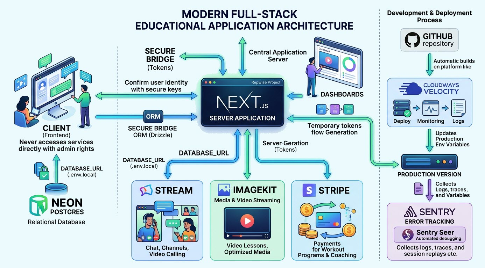
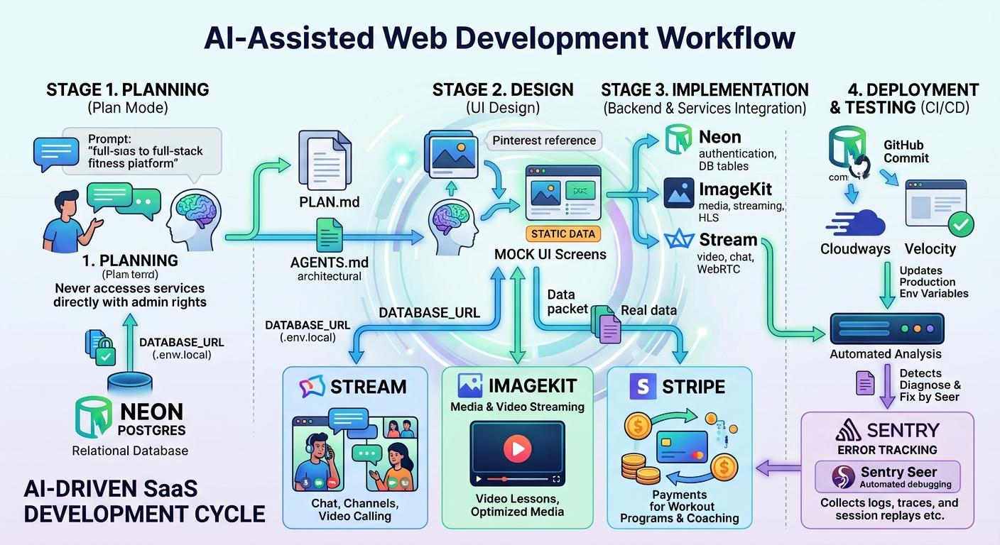
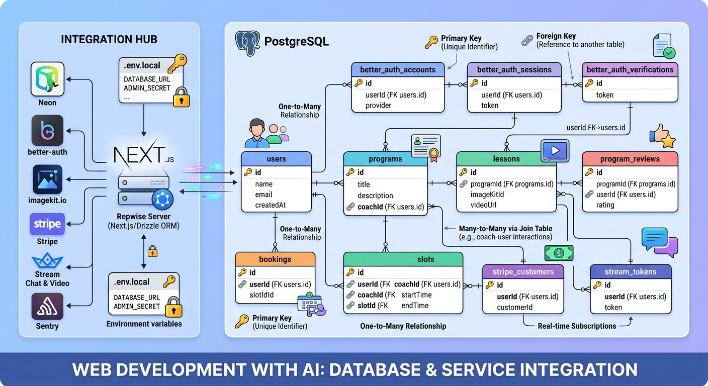
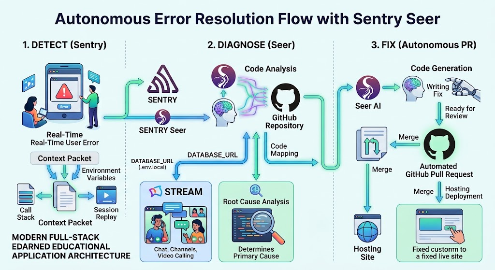

# Руководство по архитектуре, сервисам и ИИ-разработке приложения Repwise

## 1. Обзор проекта Repwise и полный технологический стек

**Repwise** — это современная бессерверная SaaS-платформа для персональных тренеров и их клиентов.



### Назначение и функционал:

- **Для клиентов:** Поиск тренеров, покупка авторских программ тренировок, просмотр видеоуроков высокого качества, общение с тренером в чате реального времени и бронирование персональных 1-on-1 онлайн-сессий.
- **Для тренеров:** Личный дашборд с аналитикой доходов, управление клиентской базой, публикация видеоуроков и гибкая настройка графиков бронирования.

### Сводная таблица используемых технологий и сервисов:

| Категория                   | Технология / Сервис                | Назначение в проекте                                               |
| --------------------------- | ---------------------------------- | ------------------------------------------------------------------ |
| **Runtime & Framework**     | **Node.js + Next.js (App Router)** | Основной серверный каркас (Fullstack TypeScript)                   |
| **База данных**             | **Neon Postgres**                  | Бессерверная облачная Postgres БД с функцией Realtime              |
| **ORM & Миграции**          | **Drizzle ORM**                    | Типобезопасное взаимодействие с БД Postgres                        |
| **Аутентификация**          | **Better Auth**                    | Серверная и клиентская авторизация (Email/Password, OAuth Google)  |
| **Медиа-сервер**            | **ImageKit**                       | Загрузка, трансформация изображений и HLS-видеостриминг            |
| **Чат и Видеозвонки**       | **Stream (GetStream.io)**          | WebRTC видеоконференции 1-on-1 и WebSocket-чат с реакциями         |
| **Платежная система**       | **Stripe**                         | Проведение транзакций, списание средств и комиссии платформы       |
| **Мониторинг & ИИ-багфикс** | **Sentry + Seer**                  | Трассировка, записи сессий (Replays) и авто-PR с исправлениями     |
| **Хостинг & CI/CD**         | **Cloudways Velocity**             | Управляемый Node.js деплоймент с автоматическим деплоем из GitHub  |
| **ИИ-разработка**           | **Claude Code / Cursor**           | Автономный агент разработки на базе модели Claude 3.5 / 3.7 Sonnet |
| **MCP Протоколы**           | **Chrome, Sentry, Higsfield MCP**  | Прямое управление браузером, issue-трекером и генерацией фонов     |

---

## 2. Полный 6-этапный рабочий процесс разработки SaaS-приложения

Разработка платформы строится по последовательному и воспроизводимому циклу:



### Этап 1: Планирование (Planning & Plan Mode)

Вместо немедленной генерации кода разработчик запускает **Plan Mode**. ИИ-агент выступает в роли интервьюера, задавая серии уточняющих вопросов по бизнес-логике, монетизации и техническим ограничениям. Итогом этапа становится генерация файлов **`PLAN.md`** и **`AGENTS.md`**.

### Этап 2: Проектирование UI на моковых данных (UI Design)

Интерфейс верстается на основе качественных визуальных референсов из Pinterest. Агент создает полностью рабочий интерфейс, заполненный **статическими моковыми (fake) данными**, без подключения реальной БД или сторонних API.

### Этап 3: Поэтапное подключение бэкенда и сервисов

Последовательная подмена моков реальной инфраструктурой:

1. Создание схем **Neon Postgres** через **Drizzle ORM** и настройка **Better Auth**;
2. Настройка **Neon Realtime** для мгновенной синхронизации слотов;
3. Подключение **ImageKit SDK** для аватаров и видеоуроков;
4. Интеграция **Stream SDK** для веб-чатов и WebRTC видеозвонков;
5. Подключение **Stripe API** для платежей.

### Этап 4: Ручная проверка и цикл доработок (Review Loop)

Каждая функция тестируется разработчиком локально (`npm run dev`). При выявлении ошибок делается скриншот и передается ИИ-агенту. Для сложной верстки агент использует **Chrome MCP** для прямого контроля браузера.

### Этап 5: Автоматический деплоймент (CI/CD)

При отправке коммита в `master` репозитория GitHub платформа **Cloudways Velocity** перехватывает событие и автоматически пересобирает продакшен-версию сайта.

### Этап 6: Мониторинг и автоматическая отладка

В приложение внедряется **Sentry SDK** (`instrumentation.ts`). При возникновении ошибок в продакшене подключается ИИ-агент **Seer**, который диагностирует проблему и открывает готовый **Pull Request** с багфиксом.

---

## 3. Серверы UI, ImageKit и Stream

### A. Генерация UI и внешние серверы

При проектировании интерфейса используются внешние генеративные сервисы (Higsfield MCP, OpenAI DALL-E 3, Gemini) для чистки скриншотов референсов от стороннего текста. Агент верстает интерфейсы Tailwind CSS на основе готовой концепции.

### B. Медиаплатформа ImageKit: SDK и трансформации

- **Пакет:** `imagekitio-next`.
- **Динамические URL-трансформации:** Изменение размеров, кадрирование и оптимизация «на лету»:  
  `https://ik.imagekit.io/your_id/tr:w-300,h-300,fo-auto/avatar.jpg`
- **Adaptive Bitrate Streaming (HLS):** Видеоуроки автоматически адаптируют качество под скорость интернета пользователя.

#### Серверная аутентификация ImageKit (`app/api/upload-auth/route.ts`):

```typescript
import ImageKit from 'imagekit'
import { NextResponse } from 'next/server'

const imagekit = new ImageKit({
  publicKey: process.env.NEXT_PUBLIC_IMAGEKIT_PUBLIC_KEY!,
  privateKey: process.env.IMAGEKIT_PRIVATE_KEY!,
  urlEndpoint: process.env.NEXT_PUBLIC_IMAGEKIT_URL_ENDPOINT!,
})

export async function GET() {
  return NextResponse.json(imagekit.getAuthenticationParameters())
}
```

#### Загрузка и оптимизация (`components/MediaUpload.tsx`):

```typescript
"use client";
import React from "react";
import { IKUpload, IKImage, ImageKitProvider } from "imagekitio-next";

const urlEndpoint = process.env.NEXT_PUBLIC_IMAGEKIT_URL_ENDPOINT;
const publicKey = process.env.NEXT_PUBLIC_IMAGEKIT_PUBLIC_KEY;

const authenticator = async () => {
  const response = await fetch("/api/upload-auth");
  if (!response.ok) {
    throw new Error("Authentication failed");
  }
  return await response.json();
};

export default function MediaUpload() {
  return (
    <ImageKitProvider
      publicKey={publicKey}
      urlEndpoint={urlEndpoint}
      authenticator={authenticator}
    >
      <IKUpload
        fileName="workout-lesson.mp4"
        onError={(err) => console.error("Upload error", err)}
        onSuccess={(res) => console.log("Uploaded File URL:", res.url)}
      />
      <IKImage
        path="/default-avatar.png"
        transformation={[
          { height: "150", width: "150", crop: "maintain_ratio" }
        ]}
        alt="Trainer Avatar"
      />
    </ImageKitProvider>
  );
}
```

### C. Сервис для чатов и видеоконференций Stream

Stream предоставляет инфраструктуру WebSocket-чатов и WebRTC-звонков без необходимости разворачивать собственные медиасерверы.

#### Серверная генерация токена Stream (`app/api/stream-token/route.ts`):

```typescript
import { StreamClient } from '@stream-io/node-sdk'
import { NextResponse } from 'next/server'

const apiKey = process.env.NEXT_PUBLIC_STREAM_API_KEY!
const secretKey = process.env.STREAM_SECRET!

export async function POST(req: Request) {
  const { userId } = await req.json()
  const serverClient = new StreamClient(apiKey, secretKey)
  const token = serverClient.generateUserToken({ user_id: userId })
  return NextResponse.json({ token })
}
```

#### Видеозвонок на клиенте (`components/VideoCall.tsx`):

```typescript
"use client";
import { useEffect, useState } from "react";
import {
  StreamVideo,
  StreamVideoClient,
  StreamCall,
  SpeakerLayout,
  CallControls,
} from "@stream-io/video-react-sdk";
import "@stream-io/video-react-sdk/dist/css/styles.css";

const apiKey = process.env.NEXT_PUBLIC_STREAM_API_KEY!;

export default function VideoCall({
  userId,
  callId,
}: {
  userId: string;
  callId: string;
}) {
  const [client, setClient] = useState<StreamVideoClient | null>(null);
  const [call, setCall] = useState<any>(null);

  useEffect(() => {
    const initVideo = async () => {
      const res = await fetch("/api/stream-token", {
        method: "POST",
        body: JSON.stringify({ userId }),
      });
      const { token } = await res.json();

      const user = { id: userId, name: `User ${userId}` };
      const videoClient = new StreamVideoClient({
        apiKey,
        user,
        token,
      });

      const myCall = videoClient.call("default", callId);
      await myCall.join({ create: true });

      setClient(videoClient);
      setCall(myCall);
    };

    initVideo();
  }, [userId, callId]);

  if (!client || !call) {
    return <div>Подключение к видеозвонку...</div>;
  }

  return (
    <StreamVideo client={client}>
      <StreamCall call={call}>
        <div className="flex flex-col h-screen">
          <SpeakerLayout />
          <CallControls />
        </div>
      </StreamCall>
    </StreamVideo>
  );
}
```

---

## 4. Схема базы данных Neon Postgres (Drizzle ORM)



Структура таблиц базы данных приложения Repwise в файле `drizzle/schema.ts`:

```typescript
import {
  pgTable,
  text,
  timestamp,
  boolean,
  integer,
  numeric,
} from 'drizzle-orm/pg-core'

// 1. Пользователи (Better Auth / Neon)
export const users = pgTable('user', {
  id: text('id').primaryKey(),
  name: text('name').notNull(),
  email: text('email').notNull().unique(),
  emailVerified: boolean('emailVerified').notNull(),
  image: text('image'),
  role: text('role').default('user'), // 'user' или 'coach'
  createdAt: timestamp('createdAt').notNull(),
  updatedAt: timestamp('updatedAt').notNull(),
})

// 2. Профили тренеров
export const profiles = pgTable('profiles', {
  id: text('id').primaryKey(),
  userId: text('user_id').references(() => users.id, {
    onDelete: 'cascade',
  }),
  headline: text('headline'),
  bio: text('bio'),
  specialties: text('specialties').array(),
  hourlyRate: integer('hourly_rate'),
  imageUrl: text('image_url'),
  rating: numeric('rating').default('5.0'),
})

// 3. Программы тренировок
export const programs = pgTable('programs', {
  id: text('id').primaryKey(),
  trainerId: text('trainer_id').references(() => users.id),
  title: text('title').notNull(),
  description: text('description'),
  price: integer('price').notNull(),
  coverImage: text('cover_image'),
  isPublished: boolean('is_published').default(false),
  createdAt: timestamp('created_at').defaultNow(),
})

// 4. Видеоуроки
export const lessons = pgTable('lessons', {
  id: text('id').primaryKey(),
  programId: text('program_id').references(() => programs.id, {
    onDelete: 'cascade',
  }),
  title: text('title').notNull(),
  videoUrl: text('video_url').notNull(),
  duration: integer('duration'),
  order: integer('order').notNull(),
})

// 5. Покупки программ
export const purchases = pgTable('purchases', {
  id: text('id').primaryKey(),
  userId: text('user_id').references(() => users.id),
  programId: text('program_id').references(() => programs.id),
  amount: integer('amount').notNull(),
  stripePaymentId: text('stripe_payment_id'),
  createdAt: timestamp('created_at').defaultNow(),
})

// 6. Слоты бронирования (Neon Realtime)
export const slots = pgTable('slots', {
  id: text('id').primaryKey(),
  trainerId: text('trainer_id').references(() => users.id),
  bookedById: text('booked_by_id').references(() => users.id),
  startTime: timestamp('start_time').notNull(),
  isBooked: boolean('is_booked').default(false),
})
```

---

## 5. Безопасность API-ключей и архитектура токенов

### Публичный ключ (Public Key / Client Key)

- **Назначение:** Идентифицирует проект на стороне браузера (например, `NEXT_PUBLIC_IMAGEKIT_PUBLIC_KEY`, `NEXT_PUBLIC_STREAM_API_KEY`).
- **Безопасность:** Передается в клиентский JS-код. Имеет права только на чтение общедоступных данных или отправку зашифрованных токенов.

### Секретный ключ (Secret Key / API Secret)

- **Назначение:** Предоставляет полный административный доступ к инфраструктуре (Stripe, ImageKit, Stream, Neon Postgres).
- **Передача по сети:**
  1. **Клиент <-> Бэкенд:** Секретный ключ **НИКОГДА** не отправляется в браузер.
  2. **Бэкенд <-> Внешний Сервис:** Передается исключительно между сервером Next.js и API стороннего сервиса по протоколу **HTTPS/TLS** (в зашифрованных HTTP-заголовках `Authorization`).

```
┌─────────────────┐        1. Запрос токена         ┌─────────────────┐
│ Client Browser  │ ──────────────────────────────> │  Next.js Server │
└─────────────────┘                                 └─────────────────┘
         ▲                                                   │
         │ 3. Временный токен                                │ 2. Секретный ключ (HTTPS/TLS)
         └───────────────────────────────────────────────────▼
                                                    ┌─────────────────┐
                                                    │ External API    │
                                                    │ (Stripe/Stream) │
                                                    └─────────────────┘
```

---

## 6. Мониторинг и автоматическое исправление ошибок: Sentry и Seer



### Автономный ИИ-агент Seer (Detect -> Diagnose -> Fix):

1. **Обнаружение (Detect):** Sentry перехватывает сбой у пользователя, запись сессии (**Session Replays**) и стек-трейс.
2. **Диагностика (Diagnose):** Seer сопоставляет пути вызова с репозиторием на GitHub (**Code Mappings**) и выявляет первопричину (_Root Cause_).
3. **Исправление (Fix):** Seer генерирует патч и **автоматически открывает Pull Request** на GitHub. Разработчику остается лишь нажать _Merge_.

### Замена ИИ-модели в Seer:

- **Локальный ИИ-агент + Sentry MCP (Рекомендуемый способ):** Подключение **Sentry MCP Server** к Claude Code или Cursor позволяет анализировать ошибки Sentry с использованием **любой произвольной модели** (Claude 3.7 Sonnet, GPT-4o, DeepSeek R1).

---

## 7. Эффективные практики работы с Claude Code

1. **Контекстные инструкции (`AGENTS.md`):** Все архитектурные соглашения фиксируются в `AGENTS.md` для сохранения контекста в любой сессии.
2. **Stream Agent Skills:** Автоматическая загрузка актуальной документации SDK через CLI (`getstream init`).
3. **Model Context Protocol (MCP):**
   - **Chrome MCP** — визуальная проверка верстки ИИ-агентом;
   - **Sentry MCP** — доступ агента к реальным сбоям продакшена;
   - **Higsfield MCP** — быстрая генерация изображений из VS Code.

---

## 8. Коллекция промптов разработки (Промпты)

В данном разделе собраны ключевые промпты, используемые автором для управления ИИ-агентами на каждом этапе проекта Repwise. Все длинные строки отформатированы с переносами.

### 8.1. Основной промпт режима планирования (Plan Mode Prompt)

_(Из оригинального Google Docs документа автора)_

```text
You are an expert full-stack developer and product manager.
Your job is to interview me about the project I am about to describe,
ask clarifying questions one by one (or in small relevant groups),
and help me design a bulletproof execution plan before we write any code.

Rules for this interview:
1. Do not generate the code right away.
2. Ask questions about business logic, target audience, key user flows,
   tech stack choices, monetization, and potential edge cases.
3. Group questions logically (e.g., Auth & Users, Database & Data Models,
   Third-Party Integrations, UI/UX Preferences).
4. After I answer your questions, summarize the technical specification
   into a structured file named `PLAN.md`.
5. Ensure `PLAN.md` includes: Architecture Overview, Tech Stack,
   Database SchemaDraft, API Routes, Step-by-Step Implementation Steps,
   and Testing Checklist.

I am about to describe my project:
"I want to build a full-stack personal training and coaching platform
using Next.js (App Router). The platform will allow users to discover
personal trainers, purchase workout programs, watch video lessons,
chat with trainers in real-time, and book private 1-on-1 coaching lessons.
Trainers should have their own dashboards to manage clients, upload
workout lessons, and track earnings."

Tech Stack to enforce:
- Database & Auth: Neon Postgres with Drizzle ORM and Better Auth.
- Realtime & Bookings: Neon Realtime.
- Payments: Stripe (with marketplace commission splits).
- Video & Chat: Stream (GetStream.io) for chat (replies, reactions,
  threads) & 1-on-1 WebRTC video calls.
- Media Handling: ImageKit for image optimizations and HLS video streaming.
- Error Tracking & Monitoring: Sentry + Seer for automated debugging.
- Hosting: Cloudways Velocity.

Please begin the interview by asking the first set of questions.
```

### 8.2. Промпт для генерации UI по визуальному референсу

```text
I have attached a UI design reference image (@design/reference.png)
and our architecture plan (@PLAN.md).

Please build the complete UI design for all application pages
(Landing, Trainer Profile, Program Checkout, Client Dashboard,
Trainer Dashboard).

Constraints:
1. Use hardcoded mock data for now. Do NOT connect backend, database,
   or authentication yet.
2. Get visual inspiration from the attached image (color palette,
   spacing, modern glassmorphic look).
3. Set reasoning effort to High.
4. Clean up background assets using Higsfield MCP or Gemini image
   generation if needed.
```

### 8.3. Промпт для подключения бэкенда Neon и Better Auth

```text
Here is the Neon documentation and connection string:
[INSERT_NEON_DOCS_OR_URL].

Tasks:
1. Read `@PLAN.md` to understand our data models.
2. Set up Drizzle ORM with Neon Postgres.
3. Replace the mock data in our UI with real database queries.
4. Implement Better Auth for user sign-up/login
   (Email + Google OAuth).
5. If there are any manual steps required in the Neon dashboard,
   provide me with a concise To-Do list.
```

### 8.4. Промпт для внедрения Stream Chat & Video (Stream Agent Skills)

```text
Integrate Stream Chat and Stream Video into our existing Next.js application.

Requirements:
1. Preserve our current authentication backend (Better Auth) and
   existing UI design.
2. Add real-time messaging with channels, reactions, replies,
   and message threads.
3. Add 1-on-1 WebRTC video calls with camera/microphone controls
   and screen sharing.
4. Use secure server-side token generation (`app/api/stream-token/route.ts`).
5. Follow the official Stream React SDK guidelines provided via
   Stream Agent Skills.
```

### 8.5. Промпт для подключения ImageKit (Медиа и HLS-видео)

```text
Add ImageKit (`imagekitio-next`) to this application following Phase 3 & 4
of `@PLAN.md`.

Requirements:
1. Create a server-side authentication route (`app/api/upload-auth/route.ts`)
   using ImageKit Private Key.
2. Replace static user avatars with `IKImage` components supporting dynamic
   URL transformations (`tr:w-300,h-300`).
3. Implement video lesson uploads (`IKUpload`) and responsive HLS video
   playback with Adaptive Bitrate Streaming.
4. Tell me which environment variables I need to add to `.env.local`
   and Cloudways Velocity.
```

### 8.6. Промпт для подключения Sentry & Seer

```text
Set up Sentry error monitoring and automated debugging in this Next.js project.

Requirements:
1. Configure `instrumentation.ts`, `sentry.server.config.ts`,
   and `sentry.client.config.ts`.
2. Enable Sentry Session Replays, Structured Logs, and Tracing.
   Remove UI masking for session replays.
3. Authenticate with Sentry MCP (`/mcp`) to allow direct reading
   of production issues.
4. Trigger a test error on purpose to verify that Seer can detect
   the issue, diagnose the root cause, and draft a Pull Request on GitHub.
```
