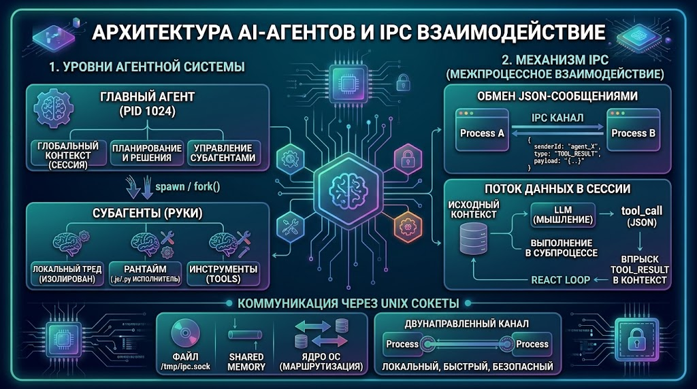
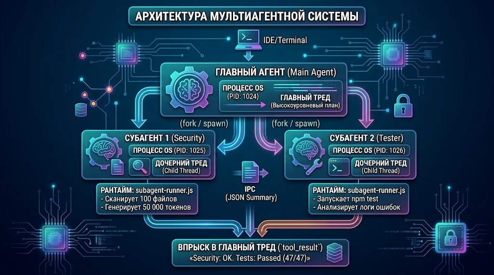
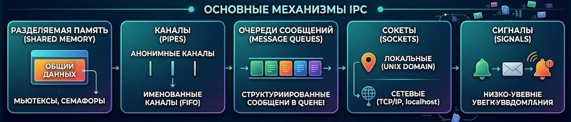
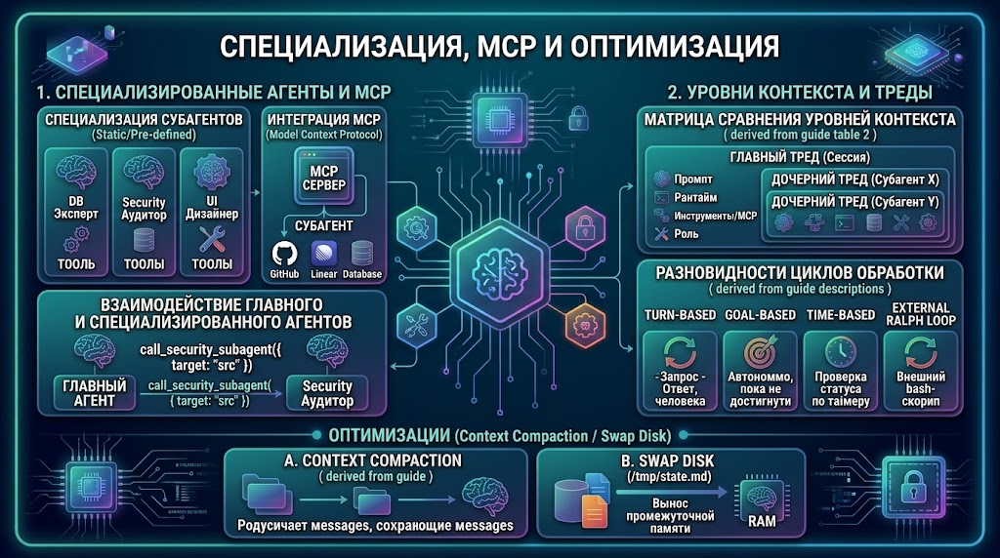
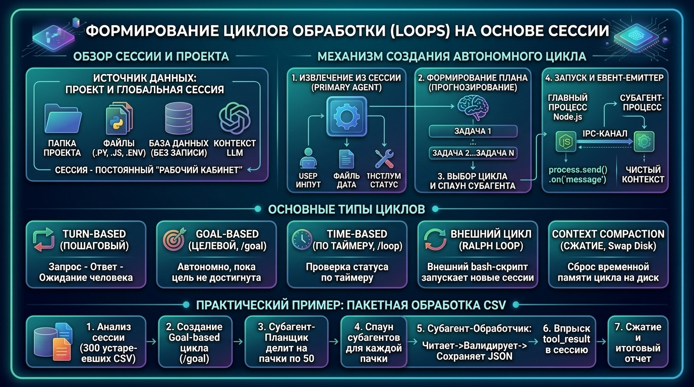

# Итоговое руководство: Архитектура AI-Агентов, IPC и Циклы

Этот документ объединяет ключевые архитектурные концепции, системные механизмы и практические примеры построения автономных мультиагентных систем.

---

## 1. Базовый контур: Проект, Сессия и Треды (Контексты)

Для правильного проектирования системы необходимо чётко разделять три уровня абстракции:

1. **Проект (Project / Workspace):**
   - **Что это:** Физическая папка на диске (`/projects/my-app`), содержащая исходный код, конфигурации, истории Git и файлы.
   - **Роль:** Постоянное хранилище и единый источник правды (Single Source of Truth).

2. **Сессия (Session):**
   - **Что это:** Системное окружение и контекст выполнения.
   - **Роль:** Хранит статус рабочей среды: текущую директорию, доступные инструменты (Tools), ключи API (`.env`) и подключенные MCP-серверы.

3. **Тред (LLM Thread / Нить диалога):**
   - **Что это:** Изолированная структура данных, содержащая историю сообщений (`system prompt`, `messages`, `tool_calls`, `tool_results`).
   - **Важное отличие:** Тред в AI — это **не поток выполнения CPU**, а контекстный контейнер в памяти LLM API.

---

## 2. Изоляция контекста и Обзор Архитектуры

Главная проблема единого чата с LLM — **замусоривание контекстного окна (Context Exhaustion)**. Если агент читает десятки файлов и получает лог из 1000 строк, его контекстное окно забивается техническим шумом.



### Схема работы мультиагентной системы:



Когда субагент завершает работу:

1. Он передает главному агенту краткое резюме (`summary`).
2. Дочерний процесс завершается (`process.exit(0)`).
3. Операционная система **освобождает RAM**, а дочерний тред со всем мусором удаляется.

---

## 3. Механизмы IPC (Inter-Process Communication)

По умолчанию процессы в ОС полностью изолированы. Для обмена данными между Главным Агентом и Субагентами используются механизмы IPC.

### Основные типы IPC:



1. **Разделяемая память (Shared Memory):** Общий участок RAM для нескольких процессов с управлением через мьютексы и семафоры.
2. **Каналы (Pipes):** Анонимные (для родительских/дочерних процессов) и именованные (FIFO в файловой системе).
3. **Очереди сообщений (Message Queues):** Хранение и передача структурированных сообщений через буфер ядра ОС.
4. **Сокеты (Sockets):**
   - _Unix Domain Sockets (`AF_UNIX`):_ Самый быстрый локальный механизм. Данные передаются напрямую через буфер ядра ОС без сетевого стека (TCP/IP).
   - _Сетевые сокеты (`TCP/IP`, `localhost`):_ Для работы по сети или между локальными портами.
5. **Сигналы (Signals):** Низкоуровневые системные уведомления (`SIGTERM`, `SIGKILL` и т.д.).

### Глубокий разбор системных каналов (Pipes), Сокетов и Разделяемой Памяти

#### 1. Как открываются и работают Каналы (Pipes) в ОС и Node.js?

При вызове родительским процессом функции `fork()` или `spawn()` в операционной системе происходят следующие системные шаги:

1. **Системный вызов `pipe()`:** Ядро Linux/Unix создает в памяти ядра двунаправленный кольцевой буфер и возвращает родительскому процессу два файловых дескриптора (`fd[0]` для чтения, `fd[1]` для записи).
2. **Системный вызов `fork()`:** Родительский процесс клонируется. Дочерний процесс автоматически **наследует таблицу файловых дескрипторов родителя**.
3. **Настройка канала связи (IPC Channel):**
   - В Node.js при вызове `fork('./subagent-runner.js')` ОС открывает невидимый анонимный пайп или сокетную пару (`socketpair`), назначая им дескрипторы (обычно **FD 3** и **FD 4**).
   - Через этот канал Node.js разворачивает обертку `process.send()` и событие `process.on('message')`, где строки автоматически сериализуются и десериализуются из JSON.
   - **STDIN/STDOUT (FD 0, FD 1, FD 2):** Стандартные потоки ввода/вывода дочернего процесса могут перенаправляться (`pipe`) в родительский процесс для перехвата консольных логов (`console.log`) независимо от управляющего IPC-канала.

#### 2. В чем разница между Каналами (Pipes) и Сокетами (Sockets)?

| Критерий                 | Каналы (Pipes / Anonymous Pipes)                                                                | Unix Domain Sockets (`AF_UNIX`)                                                 |
| :----------------------- | :---------------------------------------------------------------------------------------------- | :------------------------------------------------------------------------------ |
| **Связь процессов**      | Только между **родственными** процессами (родитель $\rightarrow$ ребенок), т.к. наследуются FD. | Между **любыми** независимыми процессами в рамках одной ОС.                     |
| **Идентификация**        | Не имеют имени/файла (анонимны в RAM ядра).                                                     | Имеют адрес — виртуальный файл на диске (`/tmp/my.sock`).                       |
| **Архитектура**          | Однонаправленные по умолчанию (для `process.send` создается пара дескрипторов).                 | Полнодуплексные (`Duplex stream`): чтение и запись через один дескриптор.       |
| **Применение в агентах** | Стандартный `child_process.fork()` в Node.js (быстрый запуск легких субагентов).                | Сервер Главного Агента, к которому динамически подключаются десятки субагентов. |

#### 3. Как устроена Разделяемая Память (Shared Memory) между процессами?

Для работы через общую память процессы должны явно **обозначить и спроецировать один и тот же виртуальный адресный пространство**:

1. **Создание объекта памяти:** Один процесс вызывает системный вызов `shm_open("/agent_shared_mem", O_CREAT | O_RDWR, 0666)` и задает размер через `ftruncate()`.
2. **Отображение в память (`mmap`):** Оба процесса (и родитель, и ребенок) вызывают `mmap()`, отображая дескриптор общего файла памяти в свое собственное виртуальное адресное пространство.
3. **Результат:** У Процесса А есть указатель `ptrA`, а у Процесса Б — `ptrB`. Физически они указывают на **одни и те же ячейки оперативной памяти (RAM)**. Запись `ptrA[0] = 42` моментально видна в `ptrB[0]` со скоростью работы шины RAM (без копирования через ядро ОС).
4. **Синхронизация:** Поскольку доступ мгновенный, процессы обязаны использовать **атомарные операции (Atomics)** или **мьютексы/семафоры в общей памяти**, чтобы не возникло состояние гонки (Race Condition).

> **В Node.js / JavaScript:** Разделяемая память между потоками/процессами реализуется через `SharedArrayBuffer` и модуль `Atomics`.

---

### Что такое Unix-сокет и дескриптор сокета?

- **Файл сокета на диске (`/tmp/ipc_agent.sock`):** Это виртуальный файл-«маяк» (размером 0 байт) с флагом `s` в ОС (`srwxr-xr-x`). Он служит в качестве адреса, по которому процессы находят друг друга.
- **Дескриптор сокета (Socket Descriptor, `sockfd`):** Целое неотрицательное число (например, `3` или `4`), которое ядро ОС выдает программе как «жетон» для доступа к созданному каналу связи.

#### Код сервера на Node.js (Главный Агент):

```javascript
// main-agent-server.js
const net = require('net')
const fs = require('fs')
const path = require('path')

const socketPath = path.join('/tmp', 'agent_ipc.sock')

if (fs.existsSync(socketPath)) {
  fs.unlinkSync(socketPath) // Удаляем старый сокет при перезапуске
}

const server = net.createServer((socket) => {
  // Аргумент socket — экземпляр net.Socket (Duplex Stream) для конкретного субагента
  console.log(`[Main Agent] Новое подключение (FD: ${socket.fd})`)

  socket.on('data', (data) => {
    const message = JSON.parse(data.toString())
    console.log(`[Main Agent] Сигнал от ${message.senderId}:`, message.payload)
  })

  socket.on('end', () => {
    console.log('[Main Agent] Субагент отключился')
  })
})

server.listen(socketPath, () => {
  console.log(`[Main Agent] IPC Сервер слушает сокет: ${socketPath}`)
})
```

---

## 4. Передача параметров и Жизненный цикл субагента

Промпт — это лишь «мысли» нейросети. Ей нужен программный **рантайм** (`subagent-runner.js`), который превращает сгенерированные текстовые JSON-команды в физические действия в ОС (чтение файлов, вызов MCP-серверов, запуск bash).

### 3 способа передачи конфигурации субагенту при старте:

1. **Аргументы командной строки (`process.argv`):** Для передачи идентификаторов и путей (`node subagent-runner.js subagent_01 /src`).
2. **Переменные окружения (`process.env`):** Для передачи системных ключей API и конфигураций.
3. **IPC Сообщения (`process.send`):** Для передачи массивных системных промптов и сложных JSON-структур.

#### Код спауна субагента (Главный Агент):

```javascript
// main-agent-launcher.js
const { fork } = require('child_process')

const subagentId = 'security_worker_01'
const scriptPath = './subagent-runner.js' // Относительный путь к файлу рантайма

const child = fork(scriptPath, [subagentId], {
  env: {
    ...process.env,
    LLM_MODEL: 'gpt-5.6-soul',
    API_KEY: 'sk-or-secret-key',
  },
})

// Отправка массивной задачи через IPC
child.send({
  type: 'INIT_TASK',
  payload: {
    prompt: 'Проверь файл src/auth.js на уязвимости OWASP',
    targetFile: 'src/auth.js',
  },
})

child.on('message', (msg) => {
  if (msg.type === 'TASK_COMPLETE') {
    console.log(`[Main Agent] Результат субагента: ${msg.payload.summary}`)
  }
})
```

#### Код рантайма субагента (`subagent-runner.js`):

```javascript
// subagent-runner.js
const fs = require('fs')

const agentId = process.argv[2] // Получаем ID из аргументов
const model = process.env.LLM_MODEL // Получаем модель из окружения

process.on('message', async (msg) => {
  if (msg.type === 'INIT_TASK') {
    const { prompt, targetFile } = msg.payload

    // 1. Читаем файл с диска (физическое действие)
    const code = fs.readFileSync(targetFile, 'utf8')

    // 2. Имитация вызова LLM и выполнения инструмента
    const summary = `Анализ ${targetFile} завершен. Ошибок не найдено.`

    // 3. Отправка отчета главному агенту
    process.send({
      senderId: agentId,
      type: 'TASK_COMPLETE',
      payload: { summary },
    })

    // 4. Завершение процесса и очистка RAM
    process.exit(0)
  }
})
```

---

## 5. Специализация, MCP и Разновидности Циклов

Для решения узкопрофильных задач применяются специализированные агенты и протокол MCP (Model Context Protocol).



### Циклы Обработки (Agentic Loops / ReAct Loops)

Нейросеть без внешнего цикла стационарна. Для создания автономной работы строится **ReAct-цикл (Reasoning + Acting)**.



#### Разновидности циклов:

- **Turn-based:** Шаг $\rightarrow$ Ответ $\rightarrow$ Ожидание вводных от человека.
- **Goal-based (`/goal`):** Автономный цикл, работающий до выполнения критерия (например: `test_exit_code === 0`).
- **Time-based (`/loop`):** Запуск по таймеру или расписанию (Cron).
- **Ralph Loop (External Shell Loop):** Внешний bash-скрипт, который перезапускает сессию агента с чистым контекстом, считывая состояние из файла `state.json` на диске.

### Схема ReAct-цикла:

$$
\text{Контекст Сессии} \longrightarrow \text{LLM Reasoning} \longrightarrow \text{Tool Call} \longrightarrow \text{Выполнение на диске} \longrightarrow \text{Впрыск } tool\_result \longrightarrow (\text{Виток замкнулся})
$$

---

## 6. Итоговая матрица компонентов системы

| Компонент                | Что это в архитектуре?         | Роль и ответственность                                                                          |
| :----------------------- | :----------------------------- | :---------------------------------------------------------------------------------------------- |
| **Проект**               | Папка на диске                 | Постоянная база кода и файлов.                                                                  |
| **Сессия**               | Окружение выполнения           | Хранит ключи, пути и текущие инструменты.                                                       |
| **Главный Агент**        | Процесс-оркестратор            | Держит контекст высокими мазками, планирует задачи.                                             |
| **Субагент**             | Дочерний субпроцесс ОС         | Выполняет грязную/емкую работу в изолированном контексте.                                       |
| **`subagent-runner.js`** | Рантайм (Обвязка на JS/Python) | Вызывает физические функции ОС, читает диск, общается с MCP.                                    |
| **Unix Socket / IPC**    | Канал связи                    | Скоростной трамплин для передачи сообщений между процессами.                                    |
| **ReAct Loop**           | Механизм управления            | Повторяет цикл «Подумай $\rightarrow$ Вызови инструмент $\rightarrow$ Оцени» до решения задачи. |
