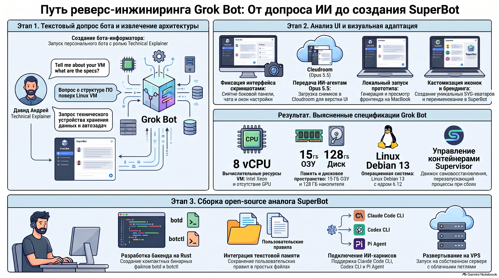
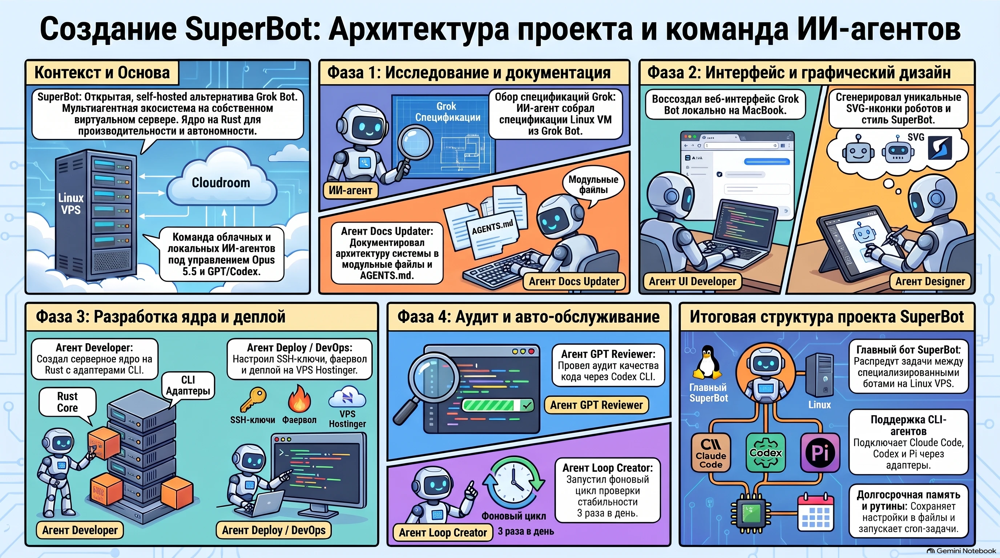
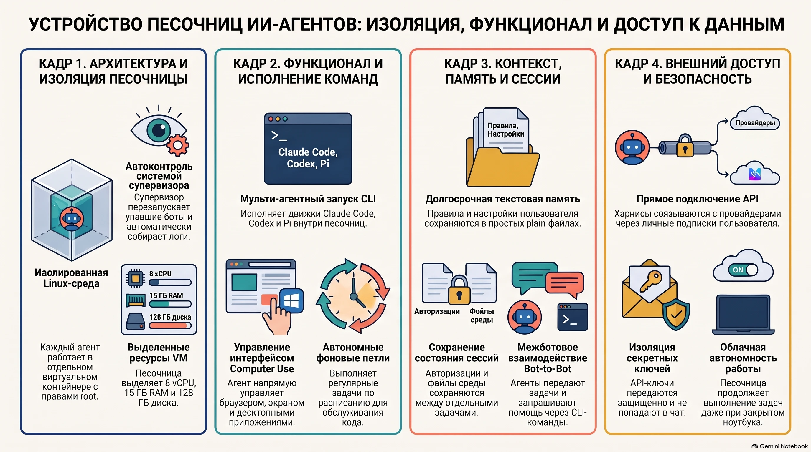
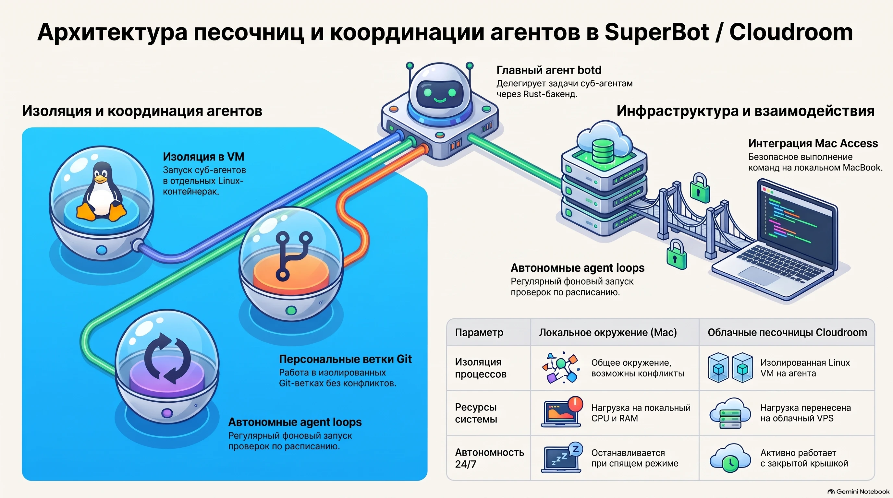
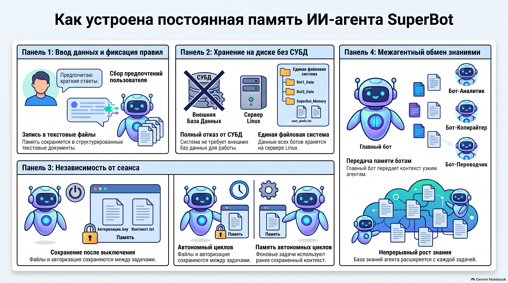

# Руководство по архитектуре SuperBot и платформе Cloudroom: Песочницы, Реверс-Инжиниринг и Мультиагентные Git-Потоки

Разработка автономных ИИ-помощников нового поколения требует перехода от локальных однопоточных скриптов к масштабируемым облачным мультиагентным системам. Проект **SuperBot**, созданный разработчиком Дэвидом Андреем (David Ondrej), представляет собой открытую (open-source), самохостируемую альтернативу проприетарному Grok Bot. В основе инфраструктуры SuperBot лежит платформа **Cloudroom**, обеспечивающая безопасную контейнеризацию, динамическую оркестрацию ИИ-инженеров и прозрачное управление контекстом.

Данное техническое руководство подробно разбирает полный цикл создания и работы системы: от проведения исследования целевого чат-бота до построения независимой от ИИ-движка (harness-agnostic) архитектуры, изоляции песочниц, организации файловой памяти и автоматизации мультиагентных Git-процессов.

---

## 1. Реверс-Инжиниринг Grok Bot: Методология и Выясненные Характеристики

Процесс воссоздания закрытого сервиса начался с технического исследования внутренней среды виртуальной машины Grok Bot. Был применен метод прямого технического диалога (prompt-driven reverse engineering).



### 1.1. Методология промптинга и роль Technical Explainer

Для получения системных сведений внутри исследуемого бота был сформирован виртуальный профиль помощника с ролью **Technical Explainer**. Через целевые текстовые запросы на английском языке удалось последовательно извлечь спецификации операционной системы и аппаратного обеспечения:

> **Ключевой диагностический запрос**: _"Tell me about your VM, what are the specs?"_ (Расскажи о своей виртуальной машине, какие у нее технические характеристики?)

Следствием данного и сопутствующих запросов стало раскрытие ботом конфигурации своего рантайма:

- **Операционная система**: Linux Debian 13 (версия ядра 6.12).
- **Вычислительные ресурсы**: 8 vCPU на базе виртуализированных процессоров Intel Xeon.
- **Оперативная память**: 15 ГБ ОЗУ (из которых порядка 2 ГБ оставалось свободным).
- **Дисковая подсистема**: 128 ГБ NVMe/SSD хранилища.
- **Графические ускорители**: Отсутствуют (GPU disabled).
- **Управление процессами**: Архитектура с супервизором процессов (**Supervisor**), выполняющим мониторинг фоновых служб и автоперезапуск при сбоях.

### 1.2. Анализ пользовательского интерфейса (UI)

Для воссоздания фронтенда Дэвид сделал серии скриншотов оригинального интерфейса и передал их в мультиагентную среду Cloudroom. Модели фронтирного уровня (в частности, Claude 3.5 Sonnet / Opus 5.5) выполнили визуальный анализ элементов управления, робо-аватаров и чат-компонентов, сразу сгенерировав готовый React/Tailwind код для интерфейса SuperBot.

---

## 2. Архитектура SuperBot и Платформа Cloudroom

Архитектура SuperBot проектировалась с расчетом на высокую производительность, минимальное потребление системных ресурсов VPS и полную независимость от конкретного поставщика ИИ-моделей.



### 2.1. Высокопроизводительный Бэкенд на Rust

Серверная часть SuperBot реализована на языке **Rust**. Бинарные исполняемые файлы `botd` (демон-супервизор) и `botctl` (CLI-утилита управления) обеспечивают:

- Минимальное потребление ОЗУ (единицы мегабайт в простое).
- Безопасность работы с памятью на этапе компиляции.
- Мгновенный запуск процессов и низкую задержку (latency) при обработке WebSocket-соединений от веб-интерфейса.

### 2.2. Harness-Agnostic Подход

Платформа Cloudroom не привязана к какому-то одному ИИ-движку. Исполнительный слой изолирован абстрактным интерфейсом адаптеров.

| Поддерживаемый Harness / Agent   | Сфера применения в SuperBot / Cloudroom                                                           |
| -------------------------------- | ------------------------------------------------------------------------------------------------- |
| Claude Code CLI                  | Основная кодогенерация, архитектурный рефакторинг и сложный анализ                                |
| Codex CLI                        | Выполнение быстрых скриптов, генерация тестов и code review                                       |
| Pi Agent                         | Легковесные автономные задачи и фоновый мониторинг                                                |
| Grok Build & Hermes Agent        | Специализированные агенты сборки и планирования                                                   |
| Расширенный стек Cloudroom (22+) | Cursor, OpenCode, Devin, Droid, fx, OpenClaw, Kimi Code, Gemini, DeepSeek Harness, GitHub Copilot |

### 2.3. Мост Безопасности Mac Access

При работе с облачными агентами возникает необходимость безопасной передачи данных на локальный компьютер. В Cloudroom реализован мост **Mac Access**:

1.  Агент в песочнице формирует запрос на локальное действие (например, запуск веб-страницы в браузере разработчика или копирование токена в буфер обмена).
2.  Данные передаются по шифрованному каналу напрямую на локальный компьютер пользователя.
3.  Конфиденциальные данные не сохраняются в истории чатов песочницы и не передаются в промпты ИИ-моделей.

---

## 3. Изоляция и Устройство Песочниц (Sandboxes)

Главное отличие Cloudroom от локальных систем запуска агентов — строгая контейнеризация каждого цифрового сотрудника.

## 



### 3.1. Концепция изолированной песочницы (Walled Off Sandbox)

Каждая задача или каждый субагент запускается в собственной изолированной Linux-песочнице (контейнере):

- **Full Admin внутри контейнера**: Внутри своей песочницы агент обладает полными административными правами, может устанавливать необходимые пакеты, создавать службы и настраивать окружение.
- **Изолированность от соседних песочниц**: Агент отгорожен (`walled off`) от хостовой системы VPS и других песочниц. Поломка окружения в одной песочнице не влияет на соседних агентов или сам сервер.

### 3.2. Преимущества Облачных Агентов перед Локальным Запуском

1.  **Автономность в фоновом режиме**: Агент продолжает выполнять сборку или тесты на VPS даже при закрытой крышке ноутбука разработчика.
2.  **Экономия ресурсов локального ПК**: Нагрузка по компиляции и работе ИИ-моделей не перегревает процессоры пользователя и не истощает заряд батареи.
3.  **Параллельное масштабирование**: Возможность одновременно запустить 10-20 агентов над разными модулями без коллизий экранов или локальных портов.

---

## 4. Механизмы Взаимодействия Песочниц, Доступ к Данным и Утилита Room CLI

Критический вопрос архитектуры — как изолированные песочницы получают доступ к общим файлам проекта и общаются между собой.

### 4.1. Доступ к Файлам Сессий и Пространству Проекта

Песочницы разворачиваются на общем VPS, где расположено базовое хранилище проекта:

- **Единый Git-репозиторий**: Все песочницы монтируют базовый репозиторий проекта, но работают в собственных Git-ветках (`own branch`).
- **Чтение сессионных данных**: Когда субагенту требуется контекст предыдущих обсуждений или решения главного агента, он считывает сессионные файлы через специализированные интерфейсы.

### 4.2. Межагентная Связь и Утилита Room CLI

Для прямой коммуникации между агентами («bot-to-bot») без участия человека используется CLI-инструмент **Room CLI**:

- **Команда отправки сообщений**: Агент в Песочнице №1 вызовом утилиты `room-cli send --to agent-2 --message "API готова"` передает статус или данные.
- **Команда чтения контекста**: Субагент вызывает `room-cli history` для получения журнала событий текущей комнаты и решений других агентов.
- **Передача управления**: Главный SuperBot через `Room CLI` распределяет подзадачи суб-агентам (Developer, UI Designer, Tester) и собирает от них итоговые статусы.

---

## 5. Организация Долгосрочной Памяти (Persistent Memory)

В отличие от систем, полагающихся на сложные векторные базы данных (Vector DB) и RAG-пайплайны, SuperBot использует файловую модель памяти.



### 5.1. Принцип текстовой файловой памяти (Plain Files)

- **Структура хранения**: Все правила, индивидуальные настройки пользователя, описания скиллов и накопленный опыт записываются в обычные текстовые файлы и Markdown-документы (например, `AGENTS.md` или `.agents/skills/`).
- **Постоянство (Persistence)**: Поскольку файлы хранятся на диске VPS, они сохраняются между перезапусками контейнеров и сессиями чата.
- **Полная прозрачность**: Пользователь в любой момент может просмотреть файлы памяти, отредактировать их вручную или спросить у бота: _"Что ты помнишь обо мне и проект?"_, получив точный ответ с демонстрацией содержимого файлов.

---

## 6. Мультиагентные Git-Потоки: Слияние, Проверка Кода и Конфликты

Параллельная работа десятков агентов над одним репозиторием требует дисциплины ветвления и управления конфликтами.

```
Main Branch -----------------------------------------> (Stable Release)
     \                                     ^
      \--> Agent Branch 1 (Feature) ------/ (rebase & GPT review)
       \--> Agent Branch 2 (Bugfix) ------/ (rebase & auto-test)
```

### 6.1. Жизненный цикл изменений (Own Branch & Rebase)

1.  **Создание изолированной ветки**: При получении задачи демон `botd` создает для агента отдельную ветку в Git (`own branch`, например `feature/ui-header`).
2.  **Изолированная разработка**: Агент вносит изменения, компилирует и тестирует код внутри своей песочницы.
3.  **Актуализация через Rebase**: Перед отправкой правок агент выполняет команду `git rebase origin/main`. Это гарантирует, что его изменения накатываются поверх самого свежего кода, созданного другими агентами.

### 6.2. Проверка Кода (Code Review & GPT Review)

Перед слиянием кода с веткой `main` активируется фаза перекрестной проверки:

- Запускается независимый агент-реактор (например, на базе `Codex CLI` или `Claude Code`), исполняющий скилл `/GPT review`.
- Агент-рецензент анализирует `git diff`, проверяет соблюдение стиля и корректность типов.
- При обнаружении замечаний код отправляется автору на доработку внутри той же песочницы.

### 6.3. Автоматическое Разрешение Конфликтов

Если возник конфликт слияния (merge conflict):

1.  Субагент через **Room CLI** запрашивает историю изменений параллельного агента.
2.  Анализирует причины конфликтующих правок в обоих файлах.
3.  Самостоятельно разрешает конфликт в Git, проводит повторный запуск тестов и выполняет `push` в `main`.

---

## 7. Автономные Фоновые Петли (Agent Loops)

**Agent Loops** — это механизм превращения ИИ-агентов из пассивных исполнителей в проактивные фоновые службы.

### 7.1. Принцип работы и настройка

- **Аналог Cron на базе ИИ**: Петля представляет собой регулярный цикл запуска агента по заданному расписанию (например, каждые 8 часов).
- **Естественный язык**: Создание петли не требует написания скриптов. Пользователь дает инструкцию: _"Создай фоновую петлю: 3 раза в день проверяй логи сервера, ищи неоптизированные запросы и создавай PR с исправлениями"_.
- **Автоматическое выполнение**: В назначенный момент `botd` поднимает временную песочницу, агент выполняет аудит, вносит изменения и завершает работу.

---

## 8. Практическое Руководство по Развертыванию SuperBot на VPS

Для запуска собственного экземпляра SuperBot выполните следующие пошаговые инструкции:

### Шаг 1: Подготовка виртуального сервера (VPS)

- Рекомендуется VPS под управлением **Ubuntu 24.04 LTS** или **Debian 12/13**.
- Минимальные требования: 2 vCPU, 4 ГБ ОЗУ, 40 ГБ SSD.
- Настройте доступ и обновите пакеты системы.

### Шаг 2: Клонирование и сборка Rust-демона

- Скопируйте репозиторий `davidondrej/superbot` с GitHub.
- Выполните сборку релиза с помощью компилятора `cargo build --release`.
- Исполняемые файлы `botd` и `botctl` будут сформированы в целевой директории `./target/release/`.

### Шаг 3: Настройка окружения и CLI-агентов

1.  Скопируйте шаблон конфигурации `cp .env.example .env`.
2.  Укажите ваши API-ключи провайдеров ИИ-моделей в файле `.env`.
3.  Авторизуйте необходимые CLI-инструменты под системным пользователем.

### Шаг 4: Запуск сервера SuperBot

Запустите демон-супервизор `./target/release/botd`. После запуска откройте веб-интерфейс SuperBot в браузере и начните работу с вашим персональным мультиагентным помощником.
